# Pluggis

[](https://github.com/ostbergjohan/pluggis/actions/workflows/build.yml) [](https://github.com/ostbergjohan/pluggis/actions/workflows/docker.yml)

An AI study buddy for students with ADHD: a student chat on the phone (as an app on the home screen) and a
parent view in the browser. The brain is Claude, which coaches with questions instead of ready-made answers and
helps the student get started, keep time and take one step at a time – with a study plan, flashcards,
reminders, points and read-aloud.

Pluggis was built for a Swedish school, so the app, the Tab5 screen and the prompts are in Swedish by default.
A student can be switched to **English** (see [Language](#language)).

> The user interface is in Swedish. UI labels are quoted in Swedish in this document, with the English meaning
> where it isn't obvious (e.g. *Öva* = Practise, *Läxor* = Homework, *Plan* = Plan).

## What's included

| Part | Status |
|---|---|
| Coach with Claude + tools (start/end sessions, save/list/complete homework) | ✅ |
| Study sessions with a timer owned by the backend | ✅ |
| Photo → Claude extracts tasks as JSON → saved as homework | ✅ |
| Flashcards: generate from a topic, text or photo, Leitner repetition, voice quiz, Anki export | ✅ |
| Points for studying with streaks and optional weekly pocket money (weekly cap) | ✅ |
| Day-by-day study plan based on what's included (pages, chapters, concepts), replanning | ✅ |
| Reminders in the chat (at study time + evening nudge, "test tomorrow") | ✅ |
| Homework in via InfoMentor's calendar subscription (webcals), .ics file, screenshot, Word, PDF or pasted text | ✅ |
| Material on homework/tests (screenshot, Word, PDF, text) → contents, new plan, optional flashcards | ✅ |
| Student chat on the phone: chat, plan, homework, material, flashcards and points | ✅ |
| Parent view: homework, plan (drag and drop), flashcards, points, cost, statistics, several students | ✅ |
| Login: parent view with a password, student chat and Tab5 with the student's code | ✅ |
| Prometheus metrics for Claude latency and tokens | ✅ |
| Audio: KB-Whisper (speech to text) + Piper (text to speech), read aloud sentence by sentence | ✅ |
| Model per job (Haiku 5.5 for voice, Sonnet 5.5 for plans/cards/photos), prompt caching | ✅ |
| Google Calendar: the plan as sessions in the student's calendar | ✅ |
| Plan from the material: reading time per page, only homework with contents is planned | ✅ |
| From the plan: 🎧 listen to the pages of a reading task, ▶ start the exercise (app and Tab5) | ✅ |
| Book page numbers on material (read by Claude, can be corrected by hand, spreads 182–183) | ✅ |
| English per student: the coach, plans, exercises, voice, speech recognition, the student app and the Tab5 in English; the parent view in Swedish or English | ✅ |
| Desk screen M5Stack Tab5: practise, chat, homework, plan, focus timer, clock on the charger, WiFi and settings on screen ([firmware/tab5](firmware/tab5)) | ✅ |

## What the student chat looks like

The student chat on an iPhone (test data).

<table>
  <tr>
    <td align="center">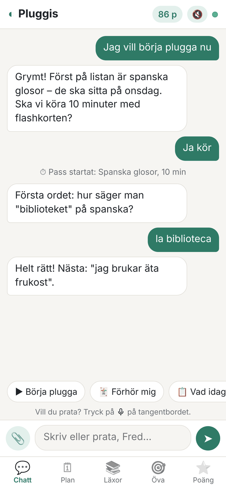<br><sub>Chat with the coach</sub></td>
    <td align="center"><br><sub>Plan – one block per subject</sub></td>
    <td align="center"><br><sub>Homework and tests</sub></td>
  </tr>
  <tr>
    <td align="center">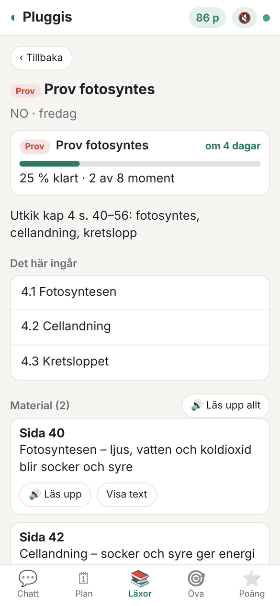<br><sub>A test's page with material</sub></td>
    <td align="center"><br><sub>Practise – six ways to study</sub></td>
    <td align="center">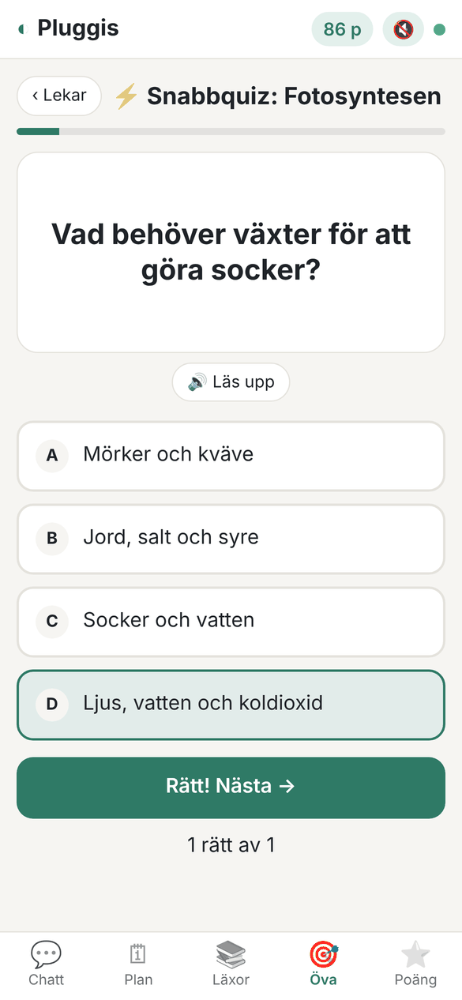<br><sub>Quick quiz</sub></td>
  </tr>
  <tr>
    <td align="center"><br><sub>Fill in the gap</sub></td>
    <td align="center">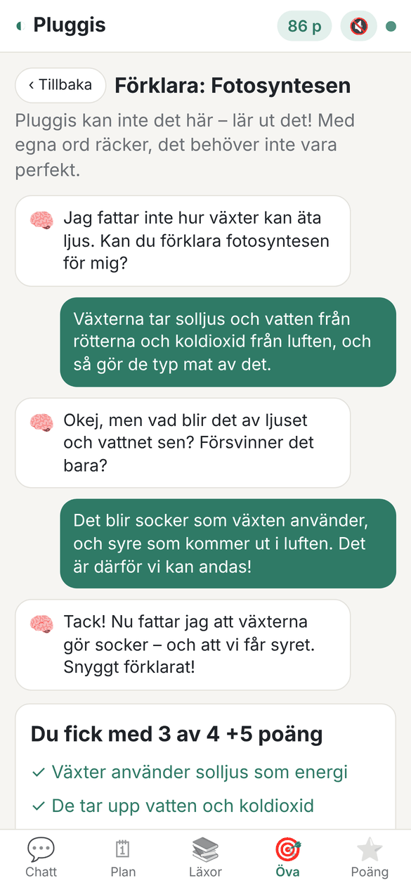<br><sub>Explain to Pluggis</sub></td>
    <td align="center">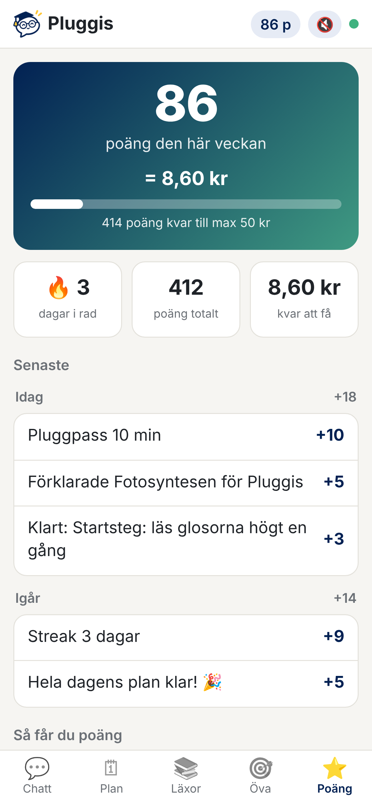<br><sub>Points and pocket money</sub></td>
  </tr>
  <tr>
    <td align="center">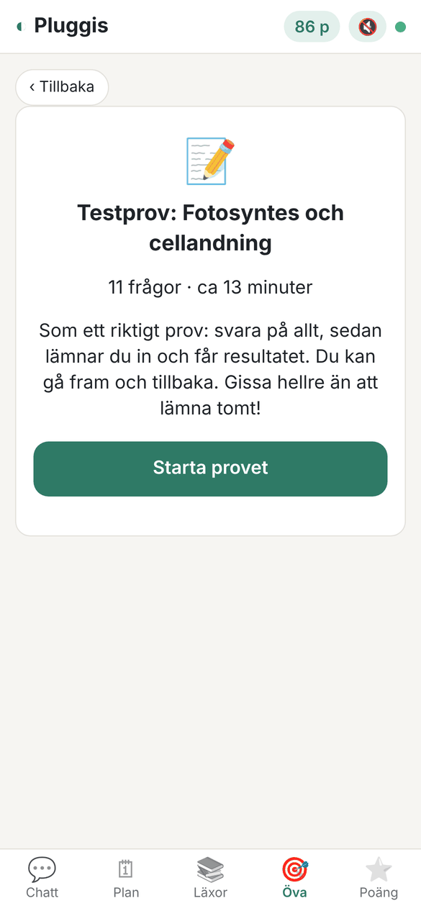<br><sub>Mock test</sub></td>
    <td align="center">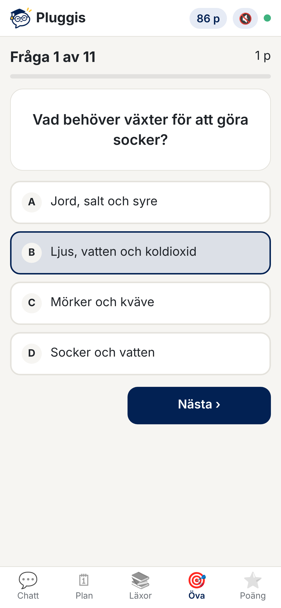<br><sub>One question at a time</sub></td>
    <td align="center">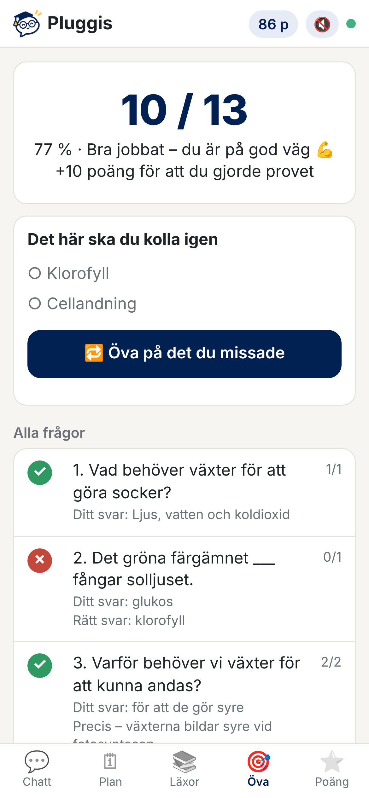<br><sub>Result and what to check again</sub></td>
  </tr>
  <tr>
    <td align="center"><br><sub>Match pairs</sub></td>
    <td align="center"><br><sub>Right order</sub></td>
    <td></td>
  </tr>
</table>

**On a computer** (or an iPad in landscape) the space is used better: the tabs become a side menu, the content is
centred and today's plan and "on the way to" are shown next to the chat.

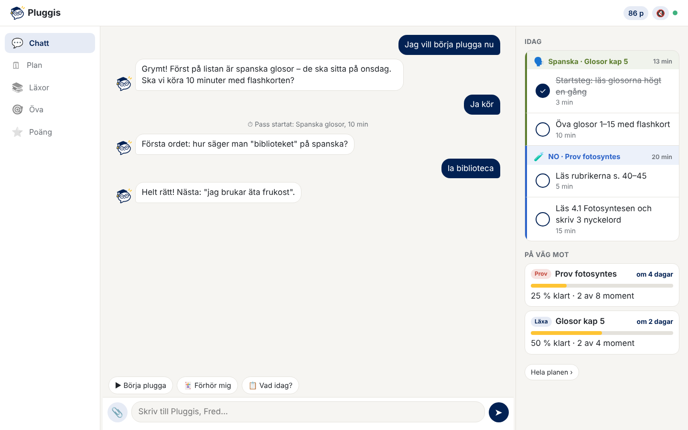

## Addresses and home screen apps

Pluggis runs on your computer/server and is reached from phones on the same network (home WiFi, or Tailscale/VPN
from outside). Replace `<server>` with the computer's address – on Linux, `hostname -I` shows it (e.g. `192.168.1.20`).

| What | Address | For |
|---|---|---|
| **Parent view (admin)** | `http://<server>:8080/admin` | You: homework, plan, students, settings, cost. Log in with the password (`PLUGGIS_ADMIN_PASSWORD` in `.env`). |
| **Student chat** | `http://<server>:8080/` | The student. Log in with the student's 5-character code. (`/chat.html` works too.) |
| **The student's personal link** | `http://<server>:8080/#k=CODE` | Logs in directly. Copy/share it under admin → System → Students. |

### Add as an app – iPhone

Do it for the student chat on the student's phone, and for admin on yours.

1. Open the link in **Safari** (it has to be Safari).
2. Tap **Share** (the square with an arrow pointing up) at the bottom.
3. Choose **Add to Home Screen** (scroll down if you can't see it), and tap **Add**.
4. The icon is called *Pluggis* (student chat) or *Pluggis admin* and opens full screen like a normal app.

The home screen app has its own login, separate from Safari: if the student is asked for the code the first time,
enter it once. New versions are fetched automatically when the app opens.

### Add as an app – Android

1. Open the link in **Chrome**.
2. Tap **⋮** (three dots top right).
3. Choose **Add to Home screen** (or **Install app** if that option is there), and confirm.
4. The *Pluggis* / *Pluggis admin* icon ends up on the home screen.

Over plain `http` it becomes a shortcut that opens in its own Chrome window; a full "installed app" needs https
(e.g. via Tailscale with HTTPS). Everything works the same.

### Icon and colours

The logo with the text *Pluggis* is the app icon and is shown on the login and the Tab5 start screen. Where it gets
too small for text (the header in chat and admin, favicon) the same logo without text is used
(`docs/brand/mark-512.png`). The figure in the speech bubble appears next to Pluggis' replies in the chat and on the
Tab5 chat tab. Originals in [`docs/brand/`](docs/brand/). The admin icon has a yellow ring so that it's different
from the student's. The colours are dark blue `#022153` and yellow `#FEC434`.
If you have already added the app to the home screen: remove it and add it again to get the new icon.

## Getting started

**Keys, tokens and accounts you need** (required/optional, where to get them, what they cost): see
[docs/configuration.md](docs/configuration.md).

Requires Java 21 and Maven.

```bash
cp .env.example .env        # fill in ANTHROPIC_API_KEY and PLUGGIS_ADMIN_PASSWORD
set -a; . ./.env; set +a
mvn spring-boot:run
```

Then open the parent view at **http://localhost:8080/admin** and log in with the password from
`PLUGGIS_ADMIN_PASSWORD`. The student chat is at **http://localhost:8080/**.

Data is stored in an H2 file under `./data`. Run with Postgres via `SPRING_PROFILES_ACTIVE=postgres`.

## Architecture

```
Student chat (phone) ── WebSocket + REST ──▶ Spring Boot "pluggis"
Tab5 (desk)          ── WebSocket + REST ──▶  │
Parent view (web)    ── REST ─────────────▶  ├─ coach/      Claude loop with tools + history
                                             ├─ homework/   homework, material, reading photos
                                             ├─ planning/   study plan, replanning, blocks per subject
                                             ├─ flashcards/ decks and repetition
                                             ├─ calendar/   InfoMentor import · gcal/ Google Calendar
                                             ├─ speech/     KB-Whisper + Piper / Azure
                                             └─ :9091/actuator/prometheus → Grafana
```

- **The prompts** are in `src/main/resources/prompts/` (in Swedish) – change the coach's tone and rules there.
- **The quick buttons** in the chat (start, quiz me, finish) become short messages to the coach,
  so the behaviour is controlled by the prompt.
- **Sessions and homework** are sent in the system prompt on every call, so the coach knows the situation
  even after a restart. The conversation itself is kept in memory and reset after 30 minutes of silence.

## Running on your Claude subscription (Claude Code)

Instead of an API key, Pluggis can run Claude via the official `claude -p` program (Claude Code), which then
draws from your Pro/Max subscription. Claude Code is already in the Docker image.

1. On your computer: install Claude Code and run `claude setup-token` (logs in in the browser and prints a token,
   valid for a year).
2. In `.env`: leave `ANTHROPIC_API_KEY` empty and set
   ```
   PLUGGIS_CLAUDE_BACKEND=claude-code
   CLAUDE_CODE_OAUTH_TOKEN=sk-ant-oat01-...
   ```
3. `docker compose up --build`. The log says "Claude körs via Claude Code" (Claude runs via Claude Code).

**Hybrid (recommended if you run on the subscription):** `PLUGGIS_CLAUDE_BACKEND=hybrid` and fill in both
`ANTHROPIC_API_KEY` and `CLAUDE_CODE_OAUTH_TOKEN`. The voice (the coach) then goes via the API key – fast and
streamed – while photos, plans, flashcards and material go on the subscription. If the subscription doesn't work
(limit reached, logged out) the job is done with the API key instead. Which jobs go via the API is controlled with
`PLUGGIS_CLAUDE_API_PURPOSES` (default `coach`).

**Switching mode in admin:** under **Cost** you choose *API key only*, *Hybrid* or *Subscription only*. The choice
takes effect immediately and is saved (also after a restart); `.env` is just the default. Modes that can't work
(e.g. the subscription without `CLAUDE_CODE_OAUTH_TOKEN`) are refused with an explanation. It also shows whether the
key, the token and the `claude` program are there, successful/failed calls via the subscription, the latest error
and how often hybrid has fallen back.

Things to keep in mind:
- In `claude-code` mode replies are not streamed, and every call starts the program – expect about a second longer
  wait in voice.
- Pluggis shares the subscription's limits with your own use of Claude and Claude Code.
- Anthropic's terms: the subscription's limits apply to "ordinary, individual usage", and services for other users
  should use an API key. This is meant for personal use at home. Read the
  [terms](https://code.claude.com/docs/en/legal-and-compliance) and switch to an API key if they change.
- The token is personal – only put it in `.env`, never in git.

## Models and audio

| Job | Default | Why |
|---|---|---|
| Voice coach | Haiku 5.5, `effort: low`, thinking off | Fastest – every second is noticeable in voice |
| Photos/screenshots | Sonnet 5.5, `effort: medium` | Handwriting and tables |
| Study plans | Sonnet 5.5, `effort: medium` | Nobody waits in real time, quality matters more |
| Flashcards | Sonnet 5.5, `effort: medium` | Good cards need judgement |
| Mock tests | Opus 5.5, `effort: medium` | Questions over all the material and marking written answers; done rarely |

Change with `PLUGGIS_COACH_MODEL` etc. (see `.env.example`). The coach's fixed rules and the tools are cached
(prompt caching); only "the situation right now" and the conversation are sent in full every time.
The reply is streamed and split into sentences that are read aloud one at a time.

**Languages:** vocabulary, cards and homework material in Spanish, German, French and English are read aloud with
Azure's voice for the language (Elvira, Katja, Denise, Sonia) – in a language subject everything is read with that
language's voice, including the Swedish parts. Requires the Azure key below; without it the phone's voice for the
language is used in the app.

**Azure's Swedish voices (optional, free):** set `AZURE_SPEECH_KEY` and `AZURE_SPEECH_REGION` in `.env`
(a Speech resource on the *Free F0* tier – 0.5 million characters/month, can't be charged). Then Sofie, Hillevi and
Mattias are available under the student's settings → Voice, with Sofie as the default. Only the coach's reply text is
sent to Azure. If Azure fails (error or the monthly limit reached) Piper takes over automatically.

**The speech service** (`speech/`) runs locally: KB-Whisper small (the National Library of Sweden's Swedish Whisper)
via faster-whisper, a multilingual Whisper small for answers in English, Spanish, German and French, and Piper with a
Swedish and an English voice. Easiest:

```bash
docker compose up --build      # Pluggis + speech, open http://localhost:8080
```

In the student chat: choose the voice *Pluggis* under 🔊 for the server's voice.

## Language

Swedish is the default for everyone. A student can be switched to English (per student, nothing else changes):

- **The coach** replies in English, and plans, quizzes, explanations, mock tests and vocabulary are made in English.
  The prompts stay in Swedish; an English instruction is added last in the system prompt for that student.
- **The voice** is English (Azure en-GB, or Piper `en_GB-alba-medium` without Azure).
- **Speech recognition** goes to the multilingual Whisper instead of KB-Whisper.
- **The student app and the Tab5** show their texts in English (the interface is written in Swedish and translated
  when it's drawn: `static/i18n*.js` for the web, `firmware/tab5/src/lang_en.h` for the Tab5).
- **Where:** the parent view → the student's tab → Coach → *The student's language* (Svenska/English).
  Or `PUT /api/student` with `{"language":"en"}`; `GET /api/chat/me` shows it.
- **The parent view** has its own language choice: **SV/EN** top right, saved in the browser.

## Web interface

Served by the same service (`src/main/resources/static`, no dependencies or build step) and works on phones.

| Tab | What |
|---|---|
| Overview | *Needs you* (homework without contents, tasks that are behind), study time, active days, answered questions (points and money only if points are on), today's plan, upcoming homework and tests, latest sessions and exercises |
| Homework & tests | Add, paste from InfoMentor, upload a file (new homework or material for an existing one), fill in what's included, plan, mark as done, delete |
| Plan | Three weeks ahead; days without tasks are merged. Drag ⠿ to move tasks between days or reorder (⋯ on phones); minutes against the daily max are shown |
| *The student's name* | Coach (name, tone, wishes, points on/off) · Planning (max per day, study days, study time) · Voice · Calendar (the school's InfoMentor calendar in, and the plan out to Google) · Points (if on) |
| System | Students and codes · Claude and cost · Log · Connection (password, log out) · Backups · Tab5 (connection status, software) |

### Several students

Each student has their own homework, plan, material, flashcards, calendar, name, tone, language and points.

- **System → Students:** add a student, change the code or delete.
- Choose which student you're looking at in the **student picker** top left in the parent view.
- Each student gets a **fixed 5-character code** (e.g. `K7M2Q`, no easily confused characters like 0/O and 1/I).
  The code is the student's login in the phone chat and on the Tab5. *New code* makes the old one invalid.
- Guessing protection: at most 20 wrong attempts per 10 minutes and address.
- Existing data from before multi-student support belongs to the first student.
- Technically: Hibernate `@TenantId` (the `student_key` column) filters homework, plan, material and flashcards
  per student; sessions, points and conversations belong to the student's device id (assigned automatically).

### Light and dark

The student chat and the parent view follow the phone's or computer's setting. The **◐** button top right switches
between *follow the device* (◐), *light* (☀) and *dark* (☾); the choice is saved in the browser. The Tab5 is always in
Pluggis blue.

### Student chat on the phone

The student chat (`/`, or `/chat.html`) is a separate, mobile-friendly page for the student (built for iPhone): chat
with Pluggis (text or 🎤), quick buttons to start studying/quiz/finish, see today's plan and tick it off, see the
homework and upload material (photo, screenshot, Word, PDF), practise (the **Öva** tab: flashcards, quick quiz,
fill in the gap and Explain to Pluggis – gives points), and see the points.

- The student opens `/` and enters their code – or gets the link with the code (`/#k=CODE`) via *Copy link* /
  *Share* under System → Students. Open in Safari → Share → *Add to Home Screen*.
- With the code the student only reaches their own things: chat, plan, homework, upload, decks (practise, not edit)
  and points – not settings, point bonuses, payouts, calendar, logs or siblings' data.
- Tap the Pluggis name in the chat to log out (e.g. on a shared phone).
- **From the plan:** reading tasks ("Läs s. 182–187" – read p. 182–187) have a **🎧 Listen** button that opens the
  homework and reads exactly those pages aloud. Reading stops after the last page and the task is ticked off.
  Exercises in the plan (quick quiz, fill in the gap, Explain to Pluggis, mock test, match pairs, right order) have
  **▶ Start**; afterwards the app asks whether the task should be ticked off. If the pages aren't in the uploaded
  material, reading starts from the beginning.
- **Listen to the material:** at the top of a homework/test there is a player that reads all uploaded material
  page by page (▶/⏸, ⏮ previous sentence, ⏭ next page, progress bar). Where the student is is saved on the homework
  so that they can continue later – also on another device – and pages that have been listened to get ✓.
  *🎧 Listen from here* on each page jumps there. The time counts as practice. Reading stops if the phone is locked
  (the browser pauses the page).

### The student and the coach's tone

Under **the student's tab → Coach**: the student's name, the coach's tone (calm, direct, playful, like an older
friend or like a sports coach) and your own wishes. They are added after the coach's fixed rules – the coach still
doesn't give ready-made answers.

Statistics are also available as JSON: `GET /api/devices/{id}/stats?days=14`.

## Homework in, planning and reminders

**The school uses InfoMentor**, which has a calendar subscription (`webcals://im2-api.infomentor.se/…`).
Under **the student's tab → Calendar** (or the shortcut **Homework & tests → 📅 Calendar**) paste the link, choose
"only homework and tests" and press **Save and sync**. It is then synced every hour; changed dates give a new plan.
The link is personal – treat it like a password (it is only stored in Pluggis' database).

Other ways in:

1. **.ics file:** same tab → *Choose .ics file*, preview and choose which events to include.
2. **Screenshot of the weekly plan:** *📷 Take a photo or upload homework* in the student chat.
3. **Paste text** from the weekly plan/weekly letter: `POST /api/homework/text` with `{"text":"..."}`.
4. **Upload a file** (image, Word .docx, PDF, .txt): *📎 Upload file* and choose **New homework or test**
   or an existing homework. Attached to a homework the file becomes *material*: Claude reads what's included
   (sections, pages, concepts), the homework is updated, the plan is redone and – if you tick the box – it becomes
   flashcards. `POST /api/homework/upload` (field `file`, repeated for several files – at most 10; optional
   `homeworkId`, `flashcards=true`). Several pages are read by Claude together; photos are scaled down in the
   browser before they're sent. Word text is read locally and saved even if Claude doesn't respond. Old .doc isn't
   supported – save as .docx.

**Page numbers in the book:** when Claude reads a photo of a book page it also reads the printed page number (a
spread becomes e.g. 182–183). That's how "Läs s. 182–187" in the plan finds the right page, and how planning knows
how long the pages take. Under **Material** on a homework in the parent view there is **🔢 Read page numbers** for
photos uploaded before this existed (Claude only sees the saved images), and the pages of each part can be corrected
or filled in by hand. `POST /api/homework/{id}/material/pages` (`?overwrite=true` reads all again) and
`PUT /api/homework/material/{id}/pages` with `{"bookPage":182,"bookPageTo":183}`.

The calendar usually only gives a title and a date – if the contents are missing the coach asks what's included.
From screenshots and text Claude extracts the homework/test, the date and the contents.

**Planning:** when the contents are there (`set_homework_content` via the coach, or
`POST /api/plan/homework/{id}/content`) Claude makes a plan with small tasks (at most ~20 min) on the study days up
to the date. **No contents, no plan:** homework or a test without "what's included", steps or uploaded material
isn't planned (old tasks are removed, and *Replan everything* shows it as skipped) – it is included once contents or
material are added.
**Reading time from the material:** Claude gets the reading time of each book page (about 140 words/min) and chooses
a suitable number of pages per reading task. The minutes of reading tasks are then recalculated from the pages (with
a margin, at least 15 and at most 30 min). Pages are always written as "s. 40–45" and exercises with their names, so
that they can be tapped in the app and on the Tab5. Before a test, new material is finished 1–2 days before and the
last days are repetition and flashcards. Ticked-off tasks give points and are kept when replanning.
**Max minutes per day and study days** are set per student under **Planning** (the max applies to all studying that
day, all homework and tests together). Tick *Redo existing plans* to replan everything.
Default for new students: `PLUGGIS_MAX_MINUTES_PER_DAY` (40) and `PLUGGIS_STUDY_DAYS`.
**Weight** (10–100 %, default 50 %) is set per homework/test in admin. Higher weight gives more time, more
repetitions and an earlier start in the plan, lower weight keeps it short. The daily max always applies; a changed
weight redoes the plan.

**Adapted for dyslexia:** the questions in all exercises are read aloud automatically when they're shown (in the app
and on the Tab5, unless the voice is off under 🔊), all material can be listened to, answers can be spoken instead of
written, and the coach and the exercises use ordinary, short words without abbreviations.

**Adapted for ADHD:**
- **One block per subject every day:** tasks are grouped per homework/test (nearest deadline first, then weight) so
  that the student doesn't jump between subjects. Each subject has a fixed colour and symbol (🧪 science, ➗ maths,
  📖 Swedish, 🇬🇧 English, 🗣️ languages, 🌍 social studies …) in the chat, admin and the calendar. Days you have
  ordered by hand keep your order.
- **Proper sessions:** every task is at least 15 minutes (at most 25), and no "just read the headings" tasks.
  Reading tasks are only reading ("Läs s. 40–45", can also be listened to in Pluggis) – the active part happens in
  separate tasks with the exercises in Pluggis, not as writing assignments. The day's most concrete task comes first
  so that it's easy to get started.
- Never two reading tasks in a row; repetition first with the book open, then without (like in the test).
- **Buffer:** the plan only fills ~80 % of the daily max and leaves a light reserve day before the test.
- **Every night** (03:30) what's behind is replanned, within the daily max – instead of piling up on the next day.
- **Whole day done** gives a +5 bonus, and the chat shows a countdown and "% done" per test/homework (the coach
  mentions it too).
- **Study time and an if-then plan** per student (Planning), e.g. "16:15, after the snack".

**Reminders:** at the student's study time (default 16:30) the chat says what's first on today's plan and what's due
tomorrow, and two hours later comes a gentle nudge if no session has been started. Only on study days.

## Google Calendar

The plan can be put in a Google Calendar: **one session per day** at the student's study time, as long as the day's
tasks, with the tasks (☐/✅) in the description and a notification when it's time. Ticked-off tasks show up after
about 15 seconds, and every night the window (3 weeks) rolls forward. Pluggis only touches its own sessions.

Pluggis uses a **service account** and talks to Google itself – nothing needs to be opened to the internet.

1. [console.cloud.google.com](https://console.cloud.google.com): create a project (e.g. *pluggis*).
2. *APIs & Services → Library*: enable the **Google Calendar API**.
3. *IAM & Admin → Service Accounts → Create*: name *pluggis*, no roles needed. Open the account →
   *Keys → Add key → JSON*. Save the file as `secrets/google-sa.json` next to `docker-compose.yml`.
4. `docker compose up -d` – the log says "Google Kalender påslagen (tjänstekonto …)" (Google Calendar on).
5. In Google Calendar: preferably create a separate calendar (*Pluggis – Fred*), open its settings →
   *Share with specific people* → add the service account's address with **Make changes to events**.
   Copy the **Calendar ID** under *Integrate calendar*.
6. Pluggis → the student's tab → **Calendar** → paste the calendar ID → *Connect and sync*.
   Share the calendar with the student and the sessions show up on the student's phone.

The calendar ID is connected per student. *Disconnect* removes upcoming sessions from the calendar.

## Flashcards and exercises

**Decks aren't kept:** every exercise is made new from the homework's material. Generated decks are temporary and
are removed automatically when they're older than 6 hours (when the student starts a new exercise). So admin no
longer has a Practise tab.

- **Quick quiz and fill in the gap:** Claude makes questions from the homework's contents and material – multiple
  choice with four options or a sentence with a gap (`___`) to fill in. The student does them from the **Öva** tab or
  the homework's page in the chat, the parent with *⚡ Make quiz* in admin, and the coach with `create_quiz`. They are
  decks like all others (same repetition and points); in the voice quiz the coach reads the options A–D aloud. The
  prompt is in `prompts/quiz.md`.
- **Explain to Pluggis:** the student gets a concept from their material ("How can plants eat light?") and explains
  it in their own words – written or with the keyboard's microphone. Pluggis plays a curious younger friend and asks
  at most two follow-up questions about what's missing, and then shows which key points were covered (✓) and what can
  be added (○). +5 points for explaining (once per concept and day). Under **Öva** and on the homework's page.
  The prompt is in `prompts/explain.md`.
- **Mock test:** a practice test that resembles the real one – about 10 questions over everything that's included
  (multiple choice, fill in the gap and 2–3 written questions), one question at a time, hand in and get the result.
  Multiple choice and gaps are marked directly, written questions by Claude (0–2 points, generously). The result page
  shows points, the right answers and "Det här ska du kolla igen" (check this again), and the missed questions become
  a deck "🔁 Repeat: …". +10 points for doing the test. The plan adds "Testprov i Pluggis" 1–2 days before the test,
  with a 📝 Start button in the chat. The prompt is in `prompts/exam.md`.
- **🧩 Match pairs:** concept and explanation (or word and translation) from the homework's decks – tap one and then
  what belongs with it. Time and record per homework (saved on the phone). Played entirely in the app, without Claude.
- **🔢 Right order:** Claude makes 2–3 sequences from the material (process steps, events, chains); the student taps
  the steps in the right order and then gets a sentence about why. The prompt is in `prompts/order.md`.
- Both give +3 points (once per exercise and day).
- **Vocabulary quiz (Tab5):** on language homework, Claude picks out the words from the material
  (`prompts/vocab.md`), the Tab5 says the word and the student answers aloud – in Swedish or in the language being
  learned.
- **Practise a sub-topic:** when the homework is selected, *Öva på: Allt · Siffror 1–100 · Veckodagar …* (practise:
  everything · numbers 1–100 · weekdays) is shown. The sub-topics are found when the material is read (older homework
  the first time, `GET /api/homework/{id}/topics`, prompt `prompts/topics.md`) and the choice applies to all the
  exercises – also on the Tab5.
- **Time in Öva counts as studying:** the app measures active time (only while it's visible and the student has
  tapped or typed in the last two minutes) and the server never counts more than the time that has actually passed.
  From 1 minute it's saved as a session – study minutes in the statistics, minute points (from 3 min) and streak, but
  no "kept the whole session" bonus. If a regular session is running the time is already counted there. If there's a
  task in today's plan for the same homework, the app asks afterwards whether it should be ticked off.

- The coach creates decks with `create_flashcards` (from a topic or the student's own material),
  or the student photographs vocabulary/notes (long press on the red button).
- Quizzing happens by voice: the coach reads the front (which is also shown on the screen), the student answers,
  the coach marks generously and the card is flipped on the screen.
- **Leitner repetition** in five boxes: right → next box (10 min, 1, 3, 7, 21 days),
  wrong → box 1 and back in 2 minutes. The prompt is in `prompts/flashcards.md`.

## Points and pocket money

The basic idea is to **reward effort more than right answers** – it's the habit of sitting down that should be built.

| What | Points |
|---|---|
| Attempt on a card | 1 (+2 if right), at most 2 times per card and day |
| Minute in a session | 1 per minute, only real time, at most the planned time, at least 3 min |
| Kept the whole session | +5 |
| Homework done | +10 |
| Task in the plan ticked off | +3 |
| Streak (days in a row with a session) | 3 × number of days (max 7) |
| Bonus from a parent | optional |

- **On/off per student:** the student's tab → Coach → *Use points*. Off hides the points button and the Points tab
  in the student chat and point notices in the chat, and the coach doesn't mention points or money. Points are still
  counted in the background.
- Points are **never** deducted.
- Kronor: `PLUGGIS_SEK_PER_POINT` (default 0.10 = 10 points/krona) with the cap `PLUGGIS_WEEKLY_CAP_SEK`
  (default 50 SEK/week). Set `PLUGGIS_REWARDS_ENABLED=false` if the coach shouldn't talk about money.
- The rules are in `RewardRules` and are easy to change.
- Money as a reward can, over time, crowd out the student's own motivation. Consider tapering off the money part once
  the habit is there, and keep the points and streaks.

## Weekly report

**The student's tab → Weekly report** (also *📄 Weekly report* on the Overview): the last seven days – time studied
and per day, days with studying, how much of the plan was done and what wasn't, how many questions were right,
points and pocket money – plus **hard right now** (questions and words that were wrong more often than right) and
**next week** (tests and homework, planned time). ‹ Previous goes back a week at a time, 🖨 Print gives a clean page.
`GET /api/report/week?weeksAgo=0`. "Hard right now" counts from when this was added (the card text is now kept
with each answer, since practice decks are removed after a few hours).

## Backups

**System → Backups** in the parent view: the whole database (homework, plans, material, points, students, settings)
is copied every night at 03:15 (can be turned off) and with **Back up now**, while Pluggis is running (H2
`BACKUP TO`). The 14 latest are kept in `data/backups` in the Docker volume (`PLUGGIS_BACKUP_KEEP` to change) and
can be downloaded or deleted there. Download one now and then and keep it somewhere else – the volume is on the
same disk. Restoring: stop Pluggis, unzip the file into the data folder (it replaces `pluggis.mv.db`) and start
again; the commands are shown in the panel. With Postgres, use `pg_dump` instead.

## Cost

The **Cost** tab in admin shows what Claude costs: this month, today, bars for the last 30 days, per function (coach,
planning, photos, flashcards …) and per student. Every call is saved per day with tokens and cost according to the
API price list (`pluggis.costs` in `application.yml`, exchange rate with `PLUGGIS_USD_SEK`, default 10 SEK/USD). Calls
that went via the subscription (Claude Code) cost nothing extra and are shown separately as "saved". The tab also
shows how much of Azure's 500,000 free characters per month has been used. The figures are an estimate – the exact
invoice is in the Claude Console.

## Thanks

The coach's ADHD-friendly way of answering is based on the rules in [i-have-adhd](https://github.com/ayghri/i-have-adhd)
(MIT), rewritten for a Swedish voice coach.

## The desk screen (M5Stack Tab5)

A Tab5 on the desk talks to the server like the student chat and only reaches the student's own data (it logs in
with the student's code). Firmware in [firmware/tab5](firmware/tab5), the interface drawn with LVGL 9 in the logo's
colours and the Atkinson Hyperlegible typeface (built to be easy to read).

- **Öva** (Practise) – homework and tests on the left, the six exercises on the right (quick quiz, fill in the gap,
  Explain/vocabulary quiz, mock test, match pairs, right order), *Öva på:* sub-topics. Questions are read aloud;
  answers can be spoken.
- **Chat** – the coach: the reply on the screen and in the speaker, *Håll in och prata* (hold and talk), a session timer.
- **Läxor** (Homework) – all material is read aloud page by page, and where you are is saved (also in the app).
- **Plan** – one day at a time; tick off, 🎧 listen to reading tasks, ▶ start exercises, ⏱ focus timer on ordinary tasks.
- **Focus timer** (15/25/45 min or the task's time), **clock on the charger** with the next test and what's left
  today, volume, battery, and WiFi, server, student code, shutdown time and brightness under ⚙.

The images are drawn with the simulator (`firmware/tab5/sim/run.sh`, test data):

<table>
  <tr>
    <td align="center"><br><sub>Start screen</sub></td>
    <td align="center"><br><sub>Practise: homework and six exercises</sub></td>
    <td align="center"><br><sub>Quick quiz</sub></td>
  </tr>
  <tr>
    <td align="center"><br><sub>Vocabulary quiz (answer by voice)</sub></td>
    <td align="center"><br><sub>Explain to Pluggis</sub></td>
    <td align="center"><br><sub>Mock test</sub></td>
  </tr>
  <tr>
    <td align="center"><br><sub>Match pairs</sub></td>
    <td align="center">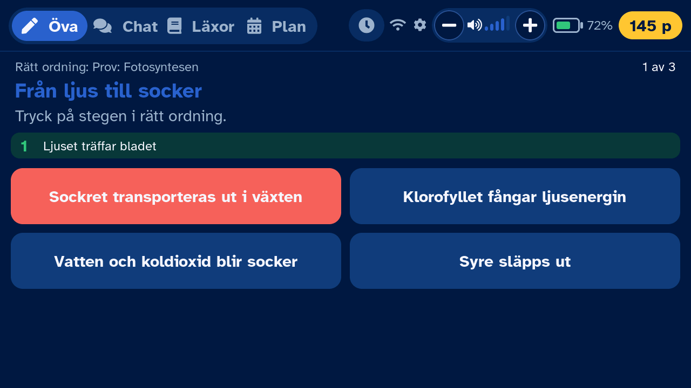<br><sub>Right order</sub></td>
    <td align="center"><br><sub>Listen to the homework page by page</sub></td>
  </tr>
  <tr>
    <td align="center"><br><sub>Plan with Listen and Start</sub></td>
    <td align="center"><br><sub>Chat with the coach</sub></td>
    <td align="center"><br><sub>Focus timer</sub></td>
  </tr>
  <tr>
    <td align="center"><br><sub>The clock on the charger</sub></td>
    <td align="center"><br><sub>Choose WiFi on the screen</sub></td>
    <td align="center">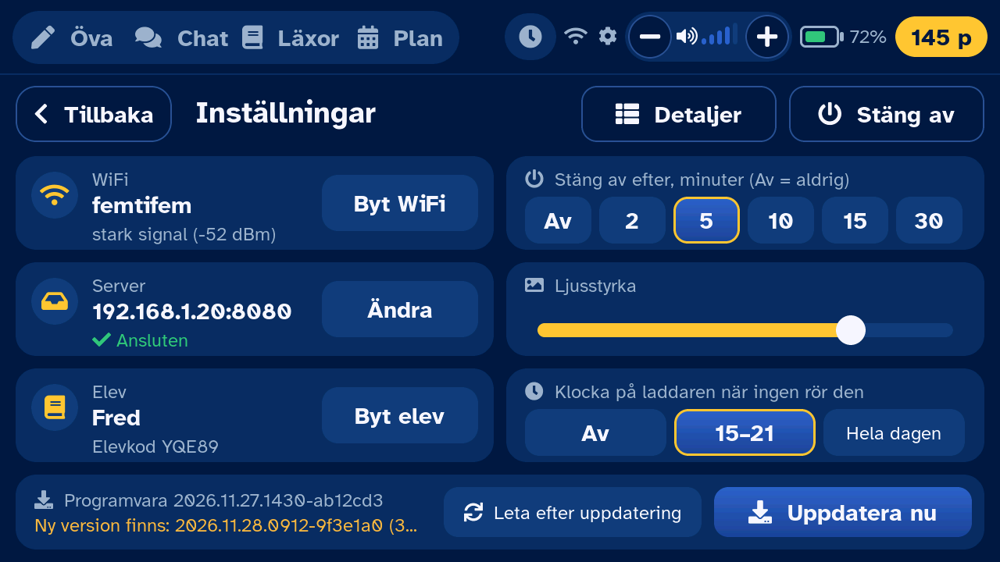<br><sub>Settings</sub></td>
  </tr>
</table>

### Supported hardware

Only the **M5Stack Tab5** (ESP32-P4), with or without a battery:

| Model | What |
|---|---|
| Tab5 Kit (K145) | With a removable NP-F550 battery – recommended, can sit on the desk without a cable |
| Tab5 (C145) | Without a battery – powered via USB-C (or a battery bought separately) |

| Part of the Tab5 | Used by Pluggis |
|---|---|
| ESP32-P4 (two RISC-V cores), 16 MB flash, 32 MB PSRAM | ✅ firmware and screen buffers (in PSRAM) |
| 5" IPS screen 1280×720 with touch (GT911, or ST7123/ST7121 on newer units) | ✅ via M5Unified/M5GFX |
| ESP32-C6 for WiFi (2.4 GHz) | ✅ 2.4 GHz networks only |
| Two microphones (ES7210) | ✅ *hold and talk* / answer by voice (speech is recognised locally on the server) |
| 1 W speaker (ES8388 + NS4150B) | ✅ the coach's voice, read-aloud, sounds for right/wrong |
| Battery and charging (INA226) | ✅ battery level, charging, shutdown, the clock mode on the charger |
| 2 MP camera (SC2356), real-time clock (RX8130CE, time is taken from the network), microSD, USB-A, RS485, Grove/M5-Bus, motion sensor (BMI270), headphone jack | – not used (homework is photographed with the phone) |

Other ESP32 screens (Core2, CoreS3, Cardputer etc.) aren't supported: the interface is built for the Tab5's 1280×720.

### Getting started with the Tab5

- Copy `include/config.example.h` to `include/config.h` and fill in the server's **IP address** and **the student's
  code** (`PLUGGIS_CODE`, the same as in the student chat). WiFi, server and code can also be chosen on the screen
  under ⚙ – it's saved in the Tab5 and takes precedence over `config.h`.
- Flash with PlatformIO: connect USB-C, hold reset for ~2 s until the green light blinks quickly, `pio run -t upload`.
- **Troubleshooting:** tap the WiFi icon or *Ansluter* (connecting) for WiFi, IP, server, the chat, the latest error
  and memory. The server logs refused screens (`docker compose logs pluggis | grep -i enhet`).

### Updating the Tab5 over WiFi

After one USB flash with this firmware, the Tab5 is updated without a cable:

1. Every push to `main` that touches `firmware/` builds `firmware.bin` in GitHub Actions and puts it, with
   `version.txt`, in the GitHub Release **`tab5`**. The version is the date and commit, e.g. `2026.11.27.1430-ab12cd3`.
2. On the Tab5: **⚙ → Check for update** (*Leta efter uppdatering*). The Pluggis server fetches the release from
   GitHub (it's the server that talks to the internet, not the Tab5) and the Tab5 compares the versions.
3. **Update now** (*Uppdatera nu*): the Tab5 downloads the file from the server, checks the MD5, writes it to the free
   app partition and restarts. Not while the focus timer runs, and not on battery below 30 %.
4. After the restart the new version must reach the server within two minutes (with WiFi up). Otherwise the Tab5
   switches back to the previous version and says so.

- **Your settings are kept:** WiFi, server, student code and the rest are stored in the Tab5 (NVS), which an update
  doesn't touch. Values that only existed in `config.h` are copied there on the first boot of this firmware, so the
  CI build (made without `config.h`) uses them too.
- **Parent view → System → Tab5:** shows the version on the server, *Check for a new version*, and *Upload* for a
  `firmware.bin` you built yourself.
- A private repo needs `PLUGGIS_GITHUB_TOKEN` (read access) in `.env`. Other repo: `PLUGGIS_FIRMWARE_REPO`.
- The automatic switch-back covers a firmware that starts but can't reach the server. A firmware that crashes before
  it gets that far needs a USB flash.

More in [firmware/tab5/README.md](firmware/tab5/README.md).

## Security and privacy

This handles a minor's voice, images and schoolwork.

- **The parent view logs in with a password.** It's set with `PLUGGIS_ADMIN_PASSWORD` in `.env` when the server
  starts (at least 8 characters) and is stored as a PBKDF2 hash; the line can then be removed. The login is a signed
  cookie (HttpOnly, SameSite=Strict) valid for 30 days. Under **System → Connection** you can change the password, log
  out or *Log out everywhere*. At most 10 wrong attempts per 10 minutes and address. Forgot the password: write a new
  one in `.env` and restart.
- **The student chat and the Tab5 use the student's code** and only reach that student's data. There is no shared
  token: without a login or a student code everything is closed.
- The student code (5 characters): at most 20 wrong attempts per 10 minutes and address and at most 300 in total
  from all addresses – the same lock for the app and the Tab5. Change the code under Students if it has leaked.
- Metrics (`/actuator/prometheus`) are only on port 9091, which docker-compose only opens to the local machine.
- **Best: reach Pluggis via Tailscale** (or another VPN) instead of opening a port to the internet – then only your
  own devices can reach it at all.
- **If it does have to be on the internet:** only behind https (e.g. Caddy or Tailscale Funnel), never port 8080
  directly, otherwise the password and the student code travel in clear text. Set `PLUGGIS_FORWARD_HEADERS=native`
  and make sure 8080 can't be reached past the proxy (e.g. `127.0.0.1:8080:8080` in docker-compose).
- The student's content isn't logged at INFO level. Keep it that way.
- Material on a homework is saved: the text (from Word/text, or as Claude read the image/PDF) and a scaled-down page
  image for photos, so that the student can look at the page again and have it read aloud. It's removed with the
  homework or the student. Images uploaded to create *new* homework aren't saved.
- Talk with the student about what is saved and what a parent can see.

## Next steps

1. An MCP server so that the same homework list can be reached from the Claude app and the home agent.
