# Pluggis

[](https://github.com/ostbergjohan/pluggis/actions/workflows/build.yml) [](https://github.com/ostbergjohan/pluggis/actions/workflows/docker.yml)

En AI-studiekompis för elever med ADHD: en elevchatt i mobilen (som app på hemskärmen) och en
föräldravy i webbläsaren. Hjärnan är Claude, som coachar med frågor i stället för färdiga svar och
hjälper eleven att komma igång, hålla tiden och ta ett steg i taget – med pluggplan, flashkort,
påminnelser, poäng och svensk uppläsning.

## Vad som finns

| Del | Status |
|---|---|
| Coach med Claude + verktyg (starta/avsluta pass, spara/lista/klarmarkera läxor) | ✅ |
| Läxpass med timer som ägs av backenden | ✅ |
| Foto → Claude läser ut uppgifter som JSON → sparas som läxor | ✅ |
| Flashkort: generera från ämne, text eller foto, Leitner-repetition, röstförhör, Anki-export | ✅ |
| Poäng för pluggande med streak och valfri veckopeng (tak per vecka) | ✅ |
| Pluggplan dag för dag utifrån vad som ingår (sidor, kapitel, begrepp), omplanering | ✅ |
| Påminnelser i chatten (vid pluggtiden + kvällsknuff, "imorgon är det prov") | ✅ |
| Läxor in via InfoMentors kalenderprenumeration (webcals), .ics-fil, skärmdump, Word, PDF eller inklistrad text | ✅ |
| Material på en läxa/prov (skärmdump, Word, PDF, text) → innehåll, ny plan, valfria flashkort | ✅ |
| Elevchatt i mobilen: chatt, plan, läxor, material, flashkort och poäng | ✅ |
| Föräldravy: läxor, plan (dra och släpp), flashkort, poäng, kostnad, statistik, flera elever | ✅ |
| Inloggning: föräldravyn med lösenord, elevchatten och Tab5 med elevens kod | ✅ |
| Prometheus-metrik för Claude-latens och tokens | ✅ |
| Ljud: KB-Whisper (tal till text) + Piper (text till tal), uppläsning mening för mening | ✅ |
| Modell per jobb (Haiku 5.5 för röst, Sonnet 5.5 för planer/kort/foto), prompt caching | ✅ |
| Google Kalender: planen som pass i elevens kalender | ✅ |
| Planen från materialet: lästid per sida, bara läxor med innehåll planeras | ✅ |
| Från planen: 🎧 Lyssna på läsmomentets sidor, ▶ Starta övningen (appen och Tab5) | ✅ |
| Sidnummer i boken på materialet (Claude läser av dem, rättas för hand, uppslag 182–183) | ✅ |
| Skrivbordsskärm M5Stack Tab5: Öva, Chat, Läxor, Plan, fokustimer, klocka på laddaren, WiFi och inställningar på skärmen ([firmware/tab5](firmware/tab5)) | ✅ |

## Så ser elevchatten ut

Elevchatten i en iPhone (testdata).

<table>
  <tr>
    <td align="center"><br><sub>Chatt med coachen</sub></td>
    <td align="center">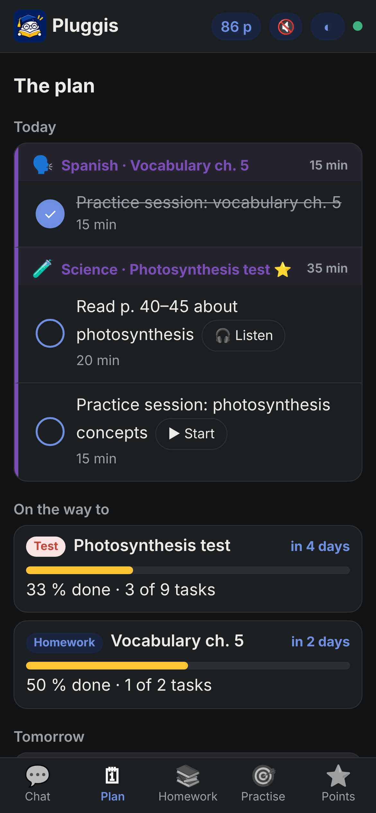<br><sub>Plan – ett block per ämne</sub></td>
    <td align="center">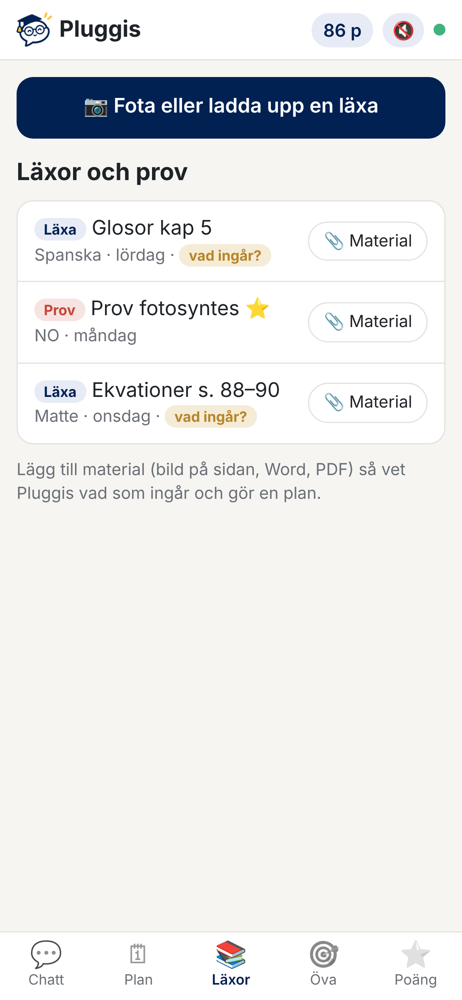<br><sub>Läxor och prov</sub></td>
  </tr>
  <tr>
    <td align="center"><br><sub>Provets sida med material</sub></td>
    <td align="center">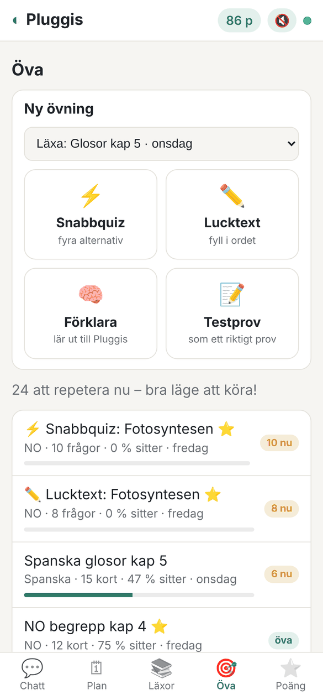<br><sub>Öva – sex sätt att plugga</sub></td>
    <td align="center"><br><sub>Snabbquiz</sub></td>
  </tr>
  <tr>
    <td align="center">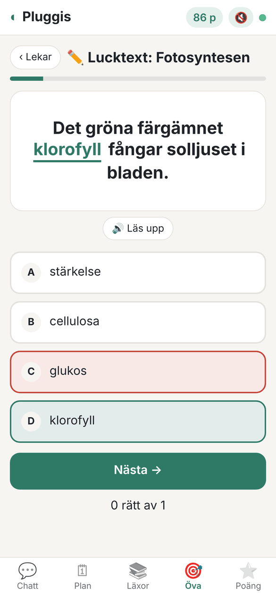<br><sub>Lucktext</sub></td>
    <td align="center"><br><sub>Förklara för Pluggis</sub></td>
    <td align="center"><br><sub>Poäng och veckopeng</sub></td>
  </tr>
  <tr>
    <td align="center"><br><sub>Testprov</sub></td>
    <td align="center"><br><sub>En fråga i taget</sub></td>
    <td align="center"><br><sub>Resultat och vad som ska kollas igen</sub></td>
  </tr>
  <tr>
    <td align="center">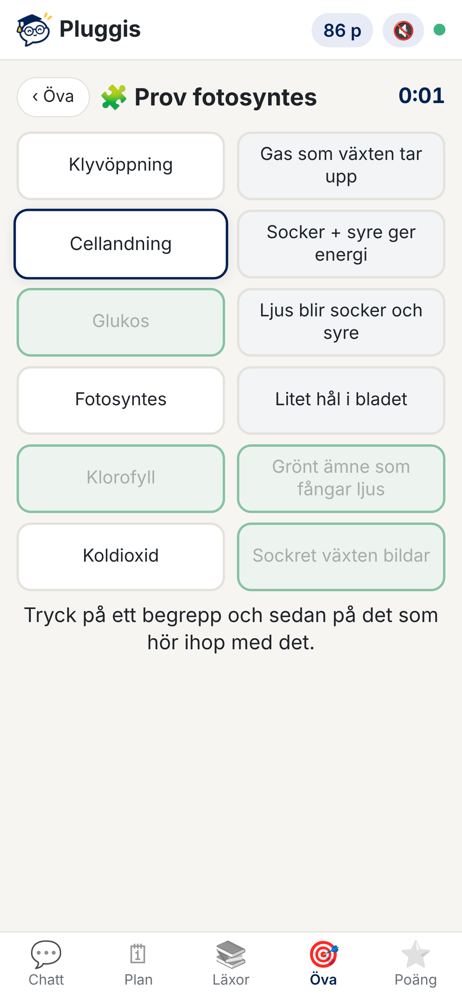<br><sub>Matcha par</sub></td>
    <td align="center">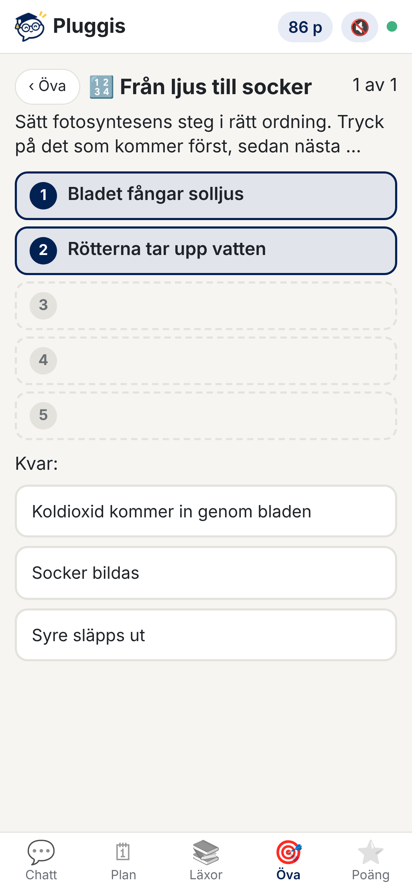<br><sub>Rätt ordning</sub></td>
    <td></td>
  </tr>
</table>

**På dator** (eller iPad liggande) används ytan bättre: flikarna blir en sidomeny, innehållet centreras och bredvid
chatten visas dagens plan och "På väg mot".


## Adresser och appar på hemskärmen

Pluggis körs på din dator/server och nås från telefoner på samma nätverk (hemma-wifi, eller via Tailscale/VPN utifrån).
Byt `<server>` mot datorns adress – på Linux syns den med `hostname -I` (t.ex. `192.168.1.20`).

| Vad | Adress | För |
|---|---|---|
| **Föräldravyn (admin)** | `http://<server>:8080/admin` | Dig: läxor, plan, elever, inställningar, kostnad. Logga in med lösenordet (`PLUGGIS_ADMIN_PASSWORD` i `.env`). |
| **Elevchatten** | `http://<server>:8080/` | Eleven. Logga in med elevens kod på 5 tecken. (`/chat.html` fungerar också.) |
| **Elevens personliga länk** | `http://<server>:8080/#k=KOD` | Loggar in direkt. Kopiera/dela den under admin → Inställningar → Elever. |

### Lägg till som app – iPhone

Gör det för elevchatten på elevens telefon, och för admin på din.

1. Öppna länken i **Safari** (det måste vara Safari).
2. Tryck på **Dela** (fyrkanten med pil uppåt) längst ner.
3. Välj **Lägg till på hemskärmen** (scrolla ner i listan om den inte syns), och tryck **Lägg till**.
4. Ikonen heter *Pluggis* (elevchatten) eller *Pluggis admin* och öppnas i helskärm som en vanlig app.

Hemskärmsappen har egen inloggning, skild från Safari: får eleven frågan om kod första gången, skriv in den en gång.
Nya versioner hämtas automatiskt när appen öppnas.

### Lägg till som app – Android

1. Öppna länken i **Chrome**.
2. Tryck på **⋮** (tre punkter uppe till höger).
3. Välj **Lägg till på startskärmen** (eller **Installera app** om det alternativet finns), och bekräfta.
4. Ikonen *Pluggis* / *Pluggis admin* hamnar på startskärmen.

Över vanlig `http` blir det en genväg som öppnas i ett eget Chrome-fönster; full "installerad app" kräver https
(t.ex. via Tailscale med HTTPS). Allt fungerar likadant.

### Ikon och färger

Loggan med texten *Pluggis* är appikon och syns på inloggningen och Tab5:s startskärm. Där det blir för litet för
text (sidhuvudet i chatt och admin, favicon) används samma logga utan texten (`docs/brand/mark-512.png`). Figuren i
pratbubblan står bredvid Pluggis svar i chatten och på Chat-fliken på Tab5. Original i [`docs/brand/`](docs/brand/). Admin-ikonen har en gul ring
så att den skiljs från elevens. Färgerna är mörkblått `#022153` och gult `#FEC434`.
Har du redan lagt till appen på hemskärmen: ta bort den och lägg till igen för att få den nya ikonen.

## Kom igång

**Nycklar, tokens och konton som behövs** (måste/valfritt, var du får dem, vad de kostar): se [docs/konfiguration.md](docs/konfiguration.md).

Kräver Java 21 och Maven.

```bash
cp .env.example .env        # fyll i ANTHROPIC_API_KEY och PLUGGIS_ADMIN_PASSWORD
set -a; . ./.env; set +a
mvn spring-boot:run
```

Öppna sedan föräldravyn på **http://localhost:8080/admin** och logga in med lösenordet från `PLUGGIS_ADMIN_PASSWORD`. Elevchatten ligger på **http://localhost:8080/**.

Data hamnar i en H2-fil under `./data`. Kör med Postgres via `SPRING_PROFILES_ACTIVE=postgres`.

## Arkitektur

```
Elevchatten (mobil) ── WebSocket + REST ──▶ Spring Boot "pluggis"
Tab5 (skrivbordet)  ── WebSocket + REST ──▶  │
Föräldravyn (webb)  ── REST ─────────────▶  ├─ coach/     Claude-loop med verktyg + historik
                                            ├─ homework/  läxor, material, fotoavläsning
                                            ├─ planning/  pluggplan, omplanering, block per ämne
                                            ├─ flashcards/ kortlekar och repetition
                                            ├─ calendar/  InfoMentor-import · gcal/ Google Kalender
                                            ├─ speech/    KB-Whisper + Piper / Azure
                                            └─ :9091/actuator/prometheus → Grafana
```

- **Prompterna** ligger i `src/main/resources/prompts/` – ändra coachens ton och regler där.
- **Snabbknapparna** i chatten (börja, förhör, avsluta) blir korta meddelanden till coachen,
  så beteendet styrs av prompten.
- **Pass och läxor** skickas med i systemprompten varje anrop, så coachen vet läget
  även efter omstart. Själva samtalet hålls i minnet och nollställs efter 30 min tystnad.

## Köra på ditt Claude-abonnemang (Claude Code)

I stället för en API-nyckel kan Pluggis köra Claude via det officiella programmet `claude -p`
(Claude Code), som då drar från ditt Pro/Max-abonnemang. Claude Code finns redan i Docker-avbilden.

1. På din dator: installera Claude Code och kör `claude setup-token` (loggar in i webbläsaren och skriver ut en token, giltig ett år).
2. I `.env`: lämna `ANTHROPIC_API_KEY` tom och sätt
   ```
   PLUGGIS_CLAUDE_BACKEND=claude-code
   CLAUDE_CODE_OAUTH_TOKEN=sk-ant-oat01-...
   ```
3. `docker compose up --build`. Loggen visar "Claude körs via Claude Code".

**Hybrid (rekommenderas om du kör på abonnemanget):** `PLUGGIS_CLAUDE_BACKEND=hybrid` och fyll i
både `ANTHROPIC_API_KEY` och `CLAUDE_CODE_OAUTH_TOKEN`. Rösten (coachen) går då via API-nyckeln – snabb
och strömmad – medan foto, planer, flashkort och material går på abonnemanget. Går abonnemanget inte
(gräns nådd, utloggat) tas jobbet med API-nyckeln i stället. Vilka jobb som går via API styrs med
`PLUGGIS_CLAUDE_API_PURPOSES` (standard `coach`).

**Byta läge i admin:** under fliken **Kostnad** väljer du *Bara API-nyckel*, *Hybrid* eller *Bara abonnemanget*.
Valet gäller direkt och sparas (även efter omstart); `.env` är bara standardläget. Lägen som inte kan fungera
(t.ex. abonnemanget utan `CLAUDE_CODE_OAUTH_TOKEN`) nekas med en förklaring. Där syns också om nyckel, token och
`claude`-programmet finns, lyckade/misslyckade anrop via abonnemanget, senaste fel och hur ofta hybrid fallit tillbaka.

Att tänka på:
- I läget `claude-code` strömmas svaren inte, och varje anrop startar programmet – räkna med någon sekund längre väntan i röst.
- Pluggis delar abonnemangets gränser med din egen användning av Claude och Claude Code.
- Anthropics villkor: abonnemangets gränser gäller "vanlig, individuell användning", och tjänster för andra
  användare ska använda API-nyckel. Det här är tänkt för eget bruk hemma. Läs
  [villkoren](https://code.claude.com/docs/en/legal-and-compliance) och byt till API-nyckel om det ändras.
- Token är personlig – lägg den bara i `.env`, aldrig i git.

## Modeller och ljud

| Jobb | Standard | Varför |
|---|---|---|
| Röstcoachen | Haiku 5.5, `effort: low`, thinking av | Snabbast – varje sekund märks i röst |
| Foto/skärmdumpar | Sonnet 5.5, `effort: medium` | Handskrift och tabeller |
| Pluggplaner | Sonnet 5.5, `effort: medium` | Ingen väntar i realtid, kvalitet viktigare |
| Flashkort | Sonnet 5.5, `effort: medium` | Bra kort kräver omdöme |
| Testprov | Opus 5.5, `effort: medium` | Frågor över hela materialet och rättning av skrivfrågor; görs sällan |

Byt med `PLUGGIS_COACH_MODEL` m.fl. (se `.env.example`). Coachens fasta regler och verktygen
cachas (prompt caching); bara "läget just nu" och samtalet skickas fullt varje gång.
Svaret strömmas och delas upp i meningar som läses upp en i taget.

**Språk:** glosor, kort och läxmaterial i spanska, tyska, franska och engelska läses upp med Azures röst för språket
(Elvira, Katja, Denise, Sonia) – i ett språkämne läses allt med språkets röst, även de svenska delarna. Kräver Azure-nyckeln nedan;
utan den används telefonens röst för språket i appen.

**Azures svenska röster (valfritt, gratis):** sätt `AZURE_SPEECH_KEY` och `AZURE_SPEECH_REGION` i `.env`
(en Speech-resurs med prisnivå *Free F0* – 0,5 miljoner tecken/månad, kan inte debiteras). Då finns
Sofie, Hillevi och Mattias under Inställningar → Röst, med Sofie som standard. Bara coachens svarstext
skickas till Azure. Går Azure inte (fel eller månadsgränsen nådd) tar Piper över automatiskt.

**Ljudtjänsten** (`speech/`) kör lokalt: KB-Whisper small (Kungliga bibliotekets svenska Whisper)
via faster-whisper, och Piper med svensk röst. Enklast:

```bash
docker compose up --build      # Pluggis + speech, öppna http://localhost:8080
```

I elevchatten: välj rösten *Pluggis* under 🔊 för serverns svenska röst.

## Webbgränssnitt

Serveras av samma tjänst (`src/main/resources/static`, inga beroenden eller byggsteg) och fungerar i mobilen.

| Flik | Vad |
|---|---|
| Översikt | *Behöver dig* (läxor utan innehåll, moment som ligger efter), pluggtid, aktiva dagar, besvarade frågor (poäng och pengar bara om poäng är på), dagens plan, kommande läxor och prov, senaste passen och övningarna |
| Läxor & prov | Lägg till, klistra in från InfoMentor, ladda upp fil (ny läxa eller material till en befintlig), fyll i vad som ingår, planera, markera klar, ta bort |
| Plan | Tre veckor framåt; dagar utan moment slås ihop. Dra ⠿ för att flytta moment mellan dagar eller ändra ordning (⋯ i mobilen); minuter mot max per dag visas |
| *Elevens namn* | Coachen (namn, ton, önskemål, poäng av/på) · Planering (max per dag, pluggdagar, pluggtid) · Röst · Kalender (skolans InfoMentor-kalender in, och planen ut till Google) · Poäng (om påslaget) |
| System | Elever och koder · Claude och kostnad · Logg · Anslutning (lösenord, logga ut) · Tab5 (visa anslutningsstatus) |

### Flera elever

Varje elev har egna läxor, plan, material, flashkort, kalender, namn, ton och poäng.

- **Inställningar → Elever:** lägg till elev, byt kod eller ta bort.
- Välj vilken elev du tittar på i **elevväljaren** uppe till vänster i föräldravyn.
- Varje elev får en **fast kod på 5 tecken** (t.ex. `K7M2Q`, inga lättförväxlade tecken som 0/O och 1/I).
  Koden är elevens inloggning i mobilchatten. *Ny kod* gör den gamla ogiltig.
- Spärr mot gissning: högst 20 felaktiga försök per 10 minuter och adress.
- Befintliga data från före flera-elever-stödet hör till den första eleven.
- Tekniskt: Hibernate `@TenantId` (kolumnen `student_key`) filtrerar läxor, plan, material och flashkort
  per elev; pass, poäng och samtal hör till elevens enhets-id.

### Ljust och mörkt

Elevchatten och föräldravyn följer telefonens eller datorns inställning. Knappen **◐** uppe till höger byter
mellan *följer enheten* (◐), *ljust* (☀) och *mörkt* (☾); valet sparas i webbläsaren. Tab5 är alltid i Pluggis blå.

### Elevchatt i mobilen

Elevchatten (`/`, eller `/chat.html`) är en egen, mobilanpassad sida för eleven (byggd för iPhone): chatta med Pluggis (text eller
🎤), snabbknappar för att börja plugga/förhör/avsluta, se dagens plan och bocka av, se läxorna och ladda upp
material (foto, skärmdump, Word, PDF), öva själv (fliken **Öva**: flashkort, snabbquiz, lucktext och Förklara för Pluggis – ger poäng), och se poängen.

- Eleven öppnar `/` och skriver in sin kod – eller får länken med koden (`/#k=KOD`) via
  *Kopiera länk* / *Dela* under Inställningar → Elever. Öppna i Safari → Dela → *Lägg till på hemskärmen*.
- Med koden når eleven bara sitt eget: chatt, plan, läxor, uppladdning, kortlekar (öva, inte ändra) och poäng – inte inställningar,
  poängbonus, utbetalningar, kalender, loggar eller syskonens data.
- Tryck på Pluggis-namnet i chatten för att logga ut (t.ex. på en delad telefon).
- **Från planen:** läsmoment ("Läs s. 182–187") har en **🎧 Lyssna**-knapp som öppnar läxan och läser upp just de
  sidorna. Uppläsningen stannar efter sista sidan och momentet bockas av. Övningar i planen ("Gör ett snabbquiz",
  lucktext, Förklara för Pluggis, testprov, matcha par, rätt ordning) har **▶ Starta**; efteråt frågar appen om
  momentet ska bockas av. Finns sidorna inte bland det inlästa materialet läses det upp från början.
- **Lyssna på materialet:** högst upp på en läxa/ett prov finns en spelare som läser upp allt inläst material sida för
  sida (▶/⏸, ⏮ förra meningen, ⏭ nästa sida, framstegsstapel). Var eleven är sparas på läxan, så att det går att
  fortsätta senare – även på en annan enhet – och sidor som lyssnats klart får ✓. *🎧 Lyssna härifrån* på varje sida
  hoppar dit. Tiden räknas som övning. Uppläsningen stannar om telefonen låses (webbläsaren pausar sidan).

### Eleven och coachens ton

Under **Inställningar → Eleven och coachen**: elevens namn, coachens ton (lugn, rak, lekfull, som en äldre
kompis eller som en idrottscoach) och egna önskemål. Det läggs till efter coachens fasta regler – coachen
ger fortfarande inga färdiga svar.

Statistik finns även som JSON: `GET /api/devices/{id}/stats?days=14`.

## Läxor in, planering och påminnelser

**Skolan använder InfoMentor**, som har en kalenderprenumeration (`webcals://im2-api.infomentor.se/…`).
Under **elevens flik → Kalender** (eller genvägen **Läxor & prov → 📅 Kalender**) klistrar du in länken, väljer "bara läxor och prov" och trycker
**Spara och synka**. Den synkas sedan varje timme; ändrade datum ger ny plan. Länken är personlig –
behandla den som ett lösenord (den sparas bara i Pluggis databas).

Andra vägar in:

1. **.ics-fil:** samma flik → *Välj .ics-fil*, förhandsgranska och välj vilka händelser som ska med.
2. **Skärmdump av veckoplanen:** *📷 Fota eller ladda upp en läxa* i elevchatten.
3. **Klistra in text** från veckoplanen/veckobrevet: `POST /api/homework/text` med `{"text":"..."}`.
4. **Ladda upp fil** (bild, Word .docx, PDF, .txt): *📎 Ladda upp fil* och välj **Ny läxa eller prov**
   eller en befintlig läxa. Kopplat till en läxa blir filen *material*: Claude läser vad som ingår
   (avsnitt, sidor, begrepp), läxan uppdateras, planen görs om och – om du kryssar i – blir det flashkort.
   `POST /api/homework/upload` (fält `file`, upprepas för flera filer – högst 10; valfritt `homeworkId`,
   `flashcards=true`). Flera sidor läses av Claude tillsammans; foton förminskas i webbläsaren innan de skickas.
   Word-text läses lokalt och sparas även om Claude inte svarar. Gamla .doc stöds inte – spara som .docx.

**Sidnummer i boken:** när Claude läser ett foto av en boksida läses också det tryckta sidnumret av (ett uppslag
blir t.ex. 182–183). Det är så "Läs s. 182–187" i planen hittar rätt sida, och planeringen vet hur lång tid sidorna
tar. Under **Material** på en läxa i föräldravyn finns **🔢 Läs av sidnummer** för foton som laddades upp innan
(Claude ser bara de sparade bilderna), och vid varje del går sidorna att rätta eller fylla i för hand.
`POST /api/homework/{id}/material/pages` (`?overwrite=true` läser om alla) och
`PUT /api/homework/material/{id}/pages` med `{"bookPage":182,"bookPageTo":183}`.

Kalendern ger oftast bara titel och datum – saknas innehållet frågar coachen vad som ingår. Från skärmdump och text läser Claude ut läxa/prov, datum och innehåll.

**Planering:** när innehållet finns (`set_homework_content` via coachen, eller
`POST /api/plan/homework/{id}/content`) gör Claude en plan med små moment (max ~20 min) på
pluggdagarna fram till datumet. **Utan innehåll ingen plan:** en läxa eller ett prov utan "vad som ingår", delsteg
och inläst material planeras inte (gamla moment tas bort, och *Planera om allt* visar den som överhoppad) – den kommer
med när innehåll eller material läggs in.
**Lästid ur materialet:** Claude får uppläsningstiden för varje boksida (ca 140 ord/min) och väljer lagom många
sidor per läsmoment. Läsmomentens minuter räknas sedan om efter sidorna (med marginal, minst 15 och högst 30 min).
Sidor skrivs alltid som "s. 40–45" och övningar med sina namn, så att de går att trycka på i appen och på Tab5. Inför prov är det nya materialet klart 1–2 dagar innan och sista
dagarna är repetition och flashkort. Avbockade moment ger poäng och ligger kvar vid omplanering.
**Max minuter per dag och pluggdagar** ställs per elev under **Inställningar → Planering** (max gäller allt
plugg den dagen, alla läxor och prov tillsammans). Kryssa i *Gör om befintliga planer* så planeras allt om.
Standard för nya elever: `PLUGGIS_MAX_MINUTES_PER_DAY` (40) och `PLUGGIS_STUDY_DAYS`.
**Vikt** (10–100 %, standard 50 %) sätts per läxa/prov i admin. Högre vikt ger mer tid, fler repetitioner och
tidigare start i planen, lägre vikt håller det kort. Max per dag gäller alltid; ändrad vikt gör om planen.

**Anpassat för dyslexi:** frågorna i alla övningar läses upp automatiskt när de visas (i appen och på Tab5, om inte
rösten är av under 🔊), allt material kan lyssnas på, svar kan sägas i stället för skrivas, och coachen och övningarna
använder vanliga, korta ord utan förkortningar.

**Anpassat för ADHD:**
- **Ett block per ämne varje dag:** momenten grupperas per läxa/prov (närmast deadline först, sedan vikt) så att eleven inte hoppar mellan ämnen. Varje ämne har fast färg och symbol (🧪 NO, ➗ matte, 📖 svenska, 🇬🇧 engelska, 🗣️ språk, 🌍 SO …) i chatten, admin och kalendern. Dagar du ordnat för hand behåller din ordning.
- **Ordentliga pass:** varje moment är minst 15 minuter (högst 25), och inga "läs bara rubrikerna"-moment. Läsmoment är bara läsning ("Läs s. 40–45", går också att lyssna på i Pluggis) – det aktiva sker i egna moment med övningarna i Pluggis, inte som skrivuppgifter. Dagens mest konkreta moment ligger först så att det är lätt att komma igång.
- Aldrig två läsmoment i rad; repetition först med boken framme, sedan utan (som på provet).
- **Buffert:** planen fyller bara ~80 % av max per dag och lämnar en lätt reservdag före provet.
- **Varje natt** (03:30) planeras det som ligger efter om, inom max per dag – i stället för att staplas på dagen efter.
- **Hela dagen klar** ger +5 i bonus, och chatten visar nedräkning och "% klart" per prov/läxa (coachen nämner det också).
- **Pluggtid och om-så-plan** per elev (Inställningar → Planering), t.ex. "16:15, efter mellanmålet".

**Påminnelser:** vid elevens pluggtid (standard 16:30) säger chatten vad som står först på dagens plan
och vad som ska in imorgon, och två timmar senare kommer en mjuk knuff om inget pass startats. Bara på pluggdagarna.

## Google Kalender

Planen kan läggas in i en Google Kalender: **ett pass per dag** vid elevens pluggtid, lika långt som dagens
moment, med momenten (☐/✅) i beskrivningen och en notis när det är dags. Avbockningar syns efter ca 15 sekunder,
och varje natt rullas fönstret (3 veckor) fram. Pluggis rör bara sina egna pass.

Pluggis använder ett **tjänstekonto** och pratar själv med Google – ingenting behöver öppnas mot internet.

1. [console.cloud.google.com](https://console.cloud.google.com): skapa ett projekt (t.ex. *pluggis*).
2. *APIs & Services → Library*: aktivera **Google Calendar API**.
3. *IAM & Admin → Service Accounts → Create*: namn *pluggis*, inga roller behövs. Öppna kontot →
   *Keys → Add key → JSON*. Spara filen som `secrets/google-sa.json` bredvid `docker-compose.yml`.
4. `docker compose up -d` – loggen visar "Google Kalender påslagen (tjänstekonto …)".
5. I Google Kalender: skapa gärna en egen kalender (*Pluggis – Fred*), öppna dess inställningar →
   *Dela med specifika personer* → lägg till tjänstekontots adress med **Gör ändringar i händelser**.
   Kopiera **Kalender-id** under *Integrera kalender*.
6. Pluggis → Inställningar → **Google Kalender** → klistra in kalender-id → *Koppla och synka*.
   Dela kalendern med eleven så dyker passen upp i elevens telefon.

Kalender-id kopplas per elev. *Koppla bort* tar bort kommande pass ur kalendern.

## Flashkort och övningar

**Kortlekar sparas inte:** varje övning görs ny av läxans material. Genererade lekar är tillfälliga och rensas
automatiskt när de är äldre än 6 timmar (när eleven gör en ny övning). Admin har därför ingen Öva-flik längre.


- **Snabbquiz och lucktext:** Claude gör frågor av läxans innehåll och material – flerval med fyra alternativ
  eller en mening med en lucka (`___`) att fylla i. Eleven gör dem från fliken **Öva** eller läxans sida i
  chatten, föräldern med *⚡ Gör quiz* i admin, och coachen med `create_quiz`. De är kortlekar som alla andra
  (samma repetition och poäng); i röstförhöret läser coachen upp alternativen A–D. Prompten finns i `prompts/quiz.md`.
- **Förklara för Pluggis:** eleven får ett begrepp ur sitt material ("Hur kan växter äta ljus?") och förklarar med egna
  ord – skrivet eller med tangentbordets mikrofon. Pluggis spelar en nyfiken yngre kompis och ställer högst två
  följdfrågor mot det som saknas, och visar sedan vilka nyckelpunkter som kom med (✓) och vad som kan läggas till (○).
  +5 poäng för att ha förklarat (en gång per begrepp och dag). Finns under **Öva** och på läxans sida.
  Prompten finns i `prompts/explain.md`.
- **Testprov:** ett övningsprov som liknar det riktiga – cirka 10 frågor över hela det som ingår (flerval, lucktext och
  2–3 skrivfrågor), en fråga i taget, lämna in och få resultatet. Flerval och lucktext rättas direkt, skrivfrågorna av
  Claude (0–2 poäng, generöst). Resultatsidan visar poäng, rätt svar och "Det här ska du kolla igen", och de missade
  frågorna blir en lek "🔁 Repetera: …". +10 poäng för att ha gjort provet. Planen lägger in "Testprov i Pluggis"
  1–2 dagar före provet, med en 📝 Starta-knapp i chatten. Prompten finns i `prompts/exam.md`.
- **🧩 Matcha par:** begrepp och förklaring (eller glosa och översättning) ur läxans kortlekar – tryck på ett och sedan
  det som hör ihop. Tid och rekord per läxa (sparas i telefonen). Spelas helt i appen, utan Claude.
- **🔢 Rätt ordning:** Claude gör 2–3 ordningar ur materialet (processteg, händelser, kedjor); eleven trycker på stegen
  i rätt ordning och får sedan en mening om varför. Prompten finns i `prompts/order.md`.
- Båda ger +3 poäng (en gång per övning och dag).
- **Öva på ett delområde:** när läxan är vald visas *Öva på: Allt · Siffror 1–100 · Veckodagar …*. Delområdena tas
  fram när materialet läses in (äldre läxor första gången, `GET /api/homework/{id}/topics`, prompt `prompts/topics.md`)
  och valet gäller alla övningarna – även på Tab5.
- **Tiden i Öva räknas som plugg:** appen mäter aktiv tid (bara när den syns och eleven tryckt eller skrivit de senaste
  två minuterna) och servern räknar aldrig mer än den tid som faktiskt gått. Från 1 minut sparas det som ett pass –
  pluggminuter i statistiken, minutpoäng (från 3 min) och streak, men ingen "höll hela passet"-bonus. Pågår ett vanligt
  pass räknas tiden redan där. Finns ett moment i dagens plan för samma läxa frågar appen efteråt om det ska bockas av.

- Coachen skapar lekar med `create_flashcards` (från ämne eller elevens eget material),
  eller så fotar eleven glosor/anteckningar (långt tryck på röda knappen).
- Förhör sker med rösten: coachen läser framsidan (som också visas på skärmen), eleven svarar,
  coachen rättar generöst och kortet vänds på skärmen.
- **Leitner-repetition** i fem fack: rätt → nästa fack (10 min, 1, 3, 7, 21 dagar),
  fel → fack 1 och tillbaka om 2 minuter. Prompten finns i `prompts/flashcards.md`.

## Poäng och veckopeng

Grundtanken är att **belöna ansträngning mer än rätt svar** – det är vanan att sätta sig som ska byggas.

| Vad | Poäng |
|---|---|
| Försök på ett kort | 1 (+2 om rätt), max 2 gånger per kort och dag |
| Minut i ett pass | 1 per minut, bara verklig tid, högst planerad tid, minst 3 min |
| Höll hela passet | +5 |
| Läxa klar | +10 |
| Moment i planen avbockat | +3 |
| Streak (dagar i rad med pass) | 3 × antal dagar (max 7) |
| Bonus från förälder | valfritt |

- **Av/på per elev:** Inställningar → Eleven och coachen → *Använd poäng*. Av döljer poängknappen och fliken Poäng i elevchatten, poängnotiser i chatten, och coachen nämner inte poäng eller pengar. Poängen räknas ändå i bakgrunden.
- Poäng dras **aldrig** av.
- Kronor: `PLUGGIS_SEK_PER_POINT` (standard 0,10 = 10 poäng/krona) med tak `PLUGGIS_WEEKLY_CAP_SEK`
  (standard 50 kr/vecka). Sätt `PLUGGIS_REWARDS_ENABLED=false` om coachen inte ska prata om pengar.
- Reglerna ligger i `RewardRules` och är lätta att ändra.
- Pengar som belöning kan på sikt tränga undan den egna motivationen. Överväg att trappa ner
  pengadelen när vanan sitter, och fortsätt med poäng och streak.

## Kostnad

Fliken **Kostnad** i admin visar vad Claude kostar: denna månad, idag, staplar för de senaste 30 dagarna, per funktion (coach, planering, foto, flashkort …) och per elev. Varje anrop sparas per dag med tokens och kostnad enligt API-prislistan (`pluggis.costs` i `application.yml`, växelkurs med `PLUGGIS_USD_SEK`, standard 10 kr/USD). Anrop som gått via abonnemanget (Claude Code) kostar inget extra och visas separat som "sparat". Fliken visar också hur mycket av Azures 500 000 gratis tecken per månad som gått åt. Siffrorna är en uppskattning – den exakta fakturan finns i Claude Console.

## Tack

Coachens ADHD-anpassade svarsform bygger på reglerna i [i-have-adhd](https://github.com/ayghri/i-have-adhd)
(MIT), omskrivna för en röstcoach på svenska.

## Skrivbordsskärmen (M5Stack Tab5)

En Tab5 på skrivbordet pratar med servern som elevchatten och når bara elevens egen data (den loggar in med
elevens kod). Firmware i [firmware/tab5](firmware/tab5), gränssnittet ritat med LVGL 9 i loggans färger och
typsnittet Atkinson Hyperlegible (byggt för att vara lättläst).

- **Öva** – läxor och prov till vänster, de sex övningarna till höger (Snabbquiz, Lucktext, Förklara/Glosförhör,
  Testprov, Matcha par, Rätt ordning), *Öva på:* delområden. Frågorna läses upp; svar kan sägas med rösten.
- **Chat** – coachen: svaret på skärmen och i högtalaren, *Håll in och prata*, timer för passet.
- **Läxor** – allt material läses upp sida för sida, och var man är sparas (även i appen).
- **Plan** – en dag i taget; bocka av, 🎧 Lyssna på läsmoment, ▶ Starta övningar, ⏱ fokustimer på vanliga moment.
- **Fokustimer** (15/25/45 min eller momentets tid), **klocka på laddaren** med nästa prov och det som är kvar idag,
  volym, batteri, och WiFi, server, elevkod, avstängningstid och ljusstyrka under ⚙.

Bilderna är ritade med simulatorn (`firmware/tab5/sim/run.sh`, testdata):

<table>
  <tr>
    <td align="center">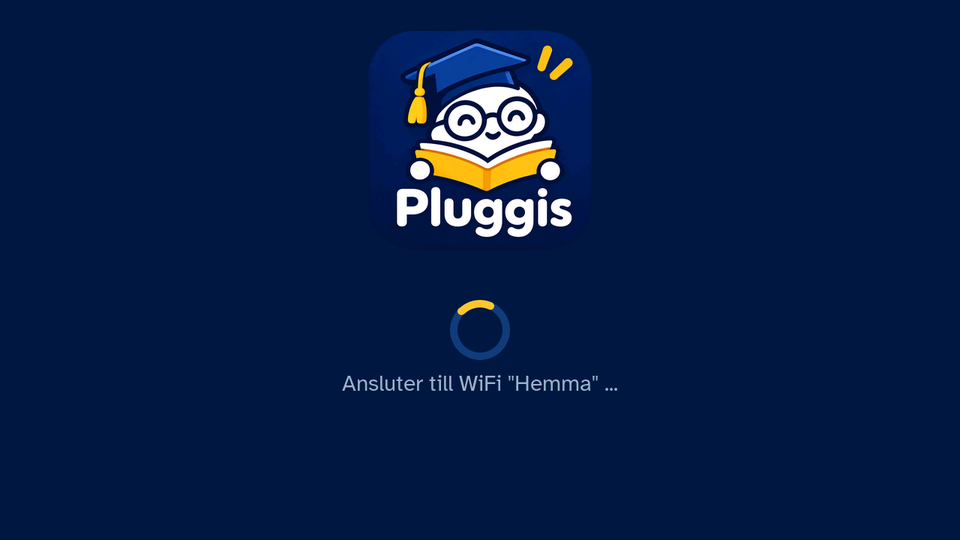<br><sub>Startskärmen</sub></td>
    <td align="center">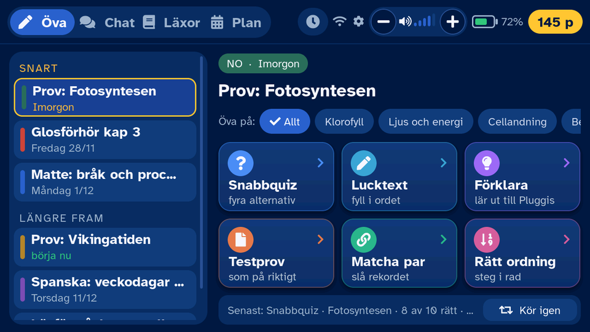<br><sub>Öva: läxor och sex övningar</sub></td>
    <td align="center">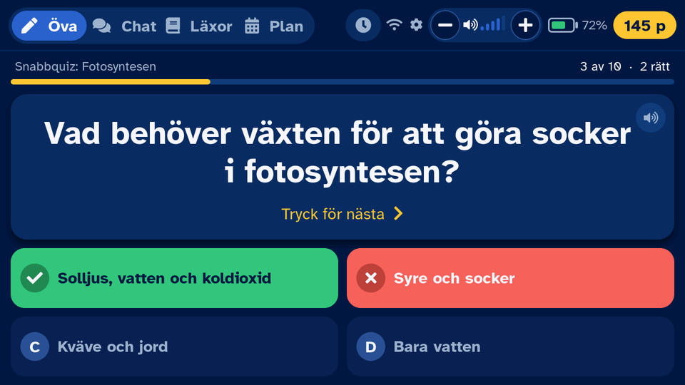<br><sub>Snabbquiz</sub></td>
  </tr>
  <tr>
    <td align="center">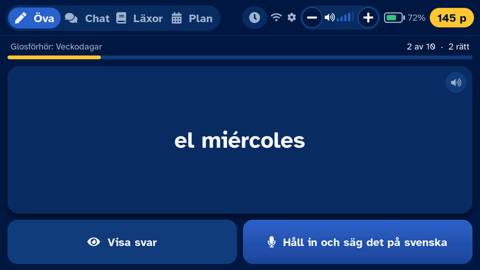<br><sub>Glosförhör (svara med rösten)</sub></td>
    <td align="center">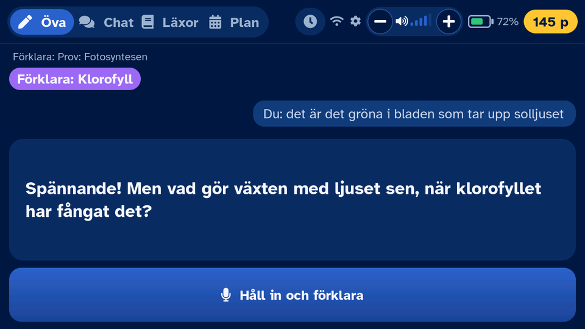<br><sub>Förklara för Pluggis</sub></td>
    <td align="center">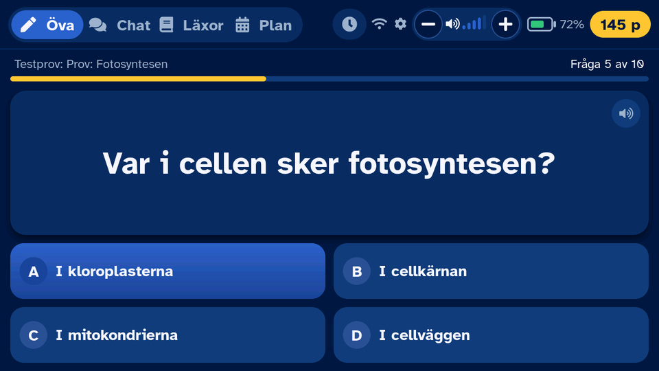<br><sub>Testprov</sub></td>
  </tr>
  <tr>
    <td align="center">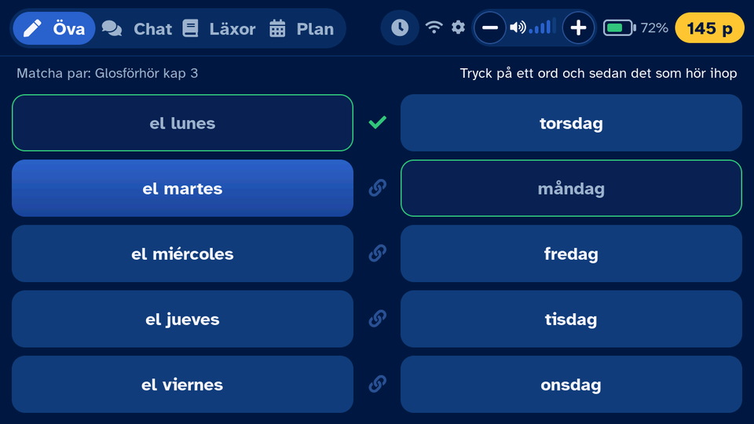<br><sub>Matcha par</sub></td>
    <td align="center"><br><sub>Rätt ordning</sub></td>
    <td align="center">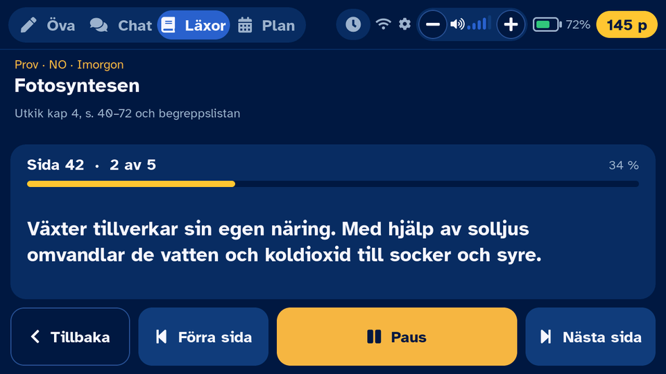<br><sub>Lyssna på läxan sida för sida</sub></td>
  </tr>
  <tr>
    <td align="center">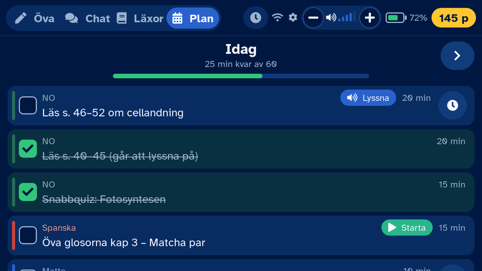<br><sub>Plan med Lyssna och Starta</sub></td>
    <td align="center">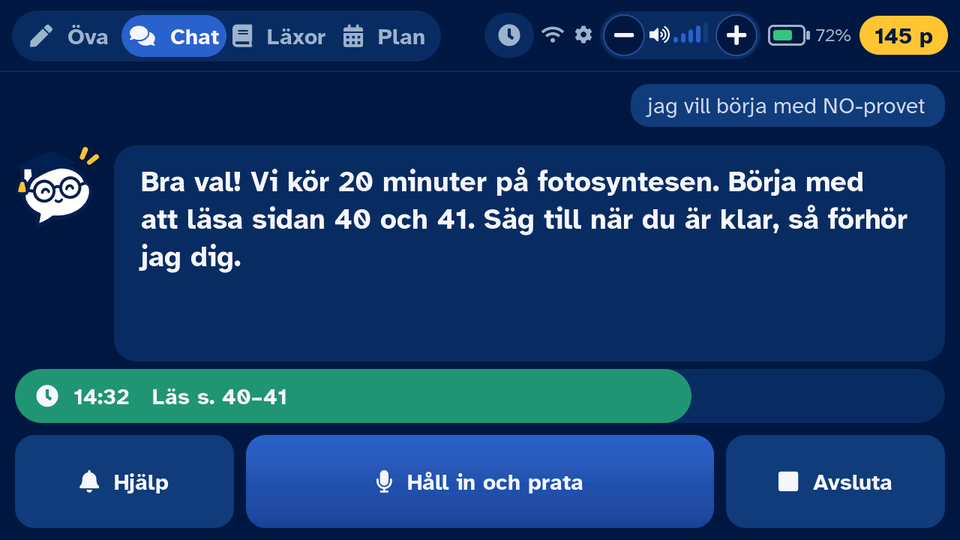<br><sub>Chat med coachen</sub></td>
    <td align="center">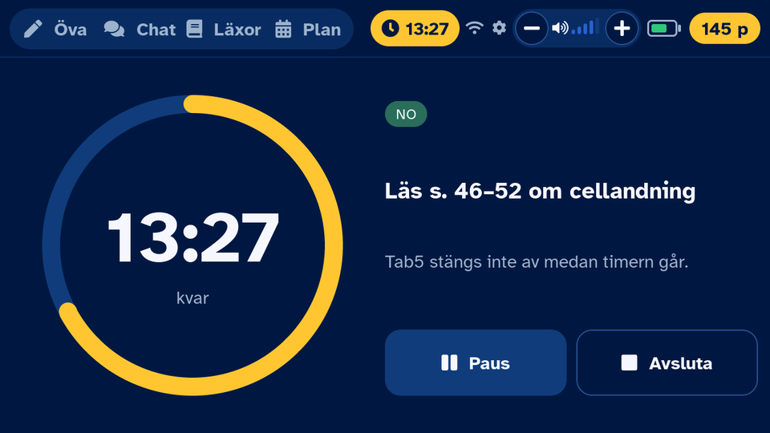<br><sub>Fokustimer</sub></td>
  </tr>
  <tr>
    <td align="center">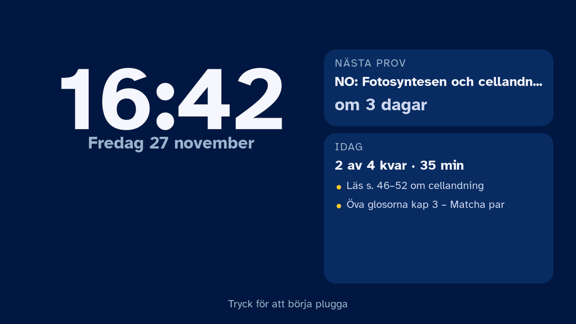<br><sub>Klockan på laddaren</sub></td>
    <td align="center">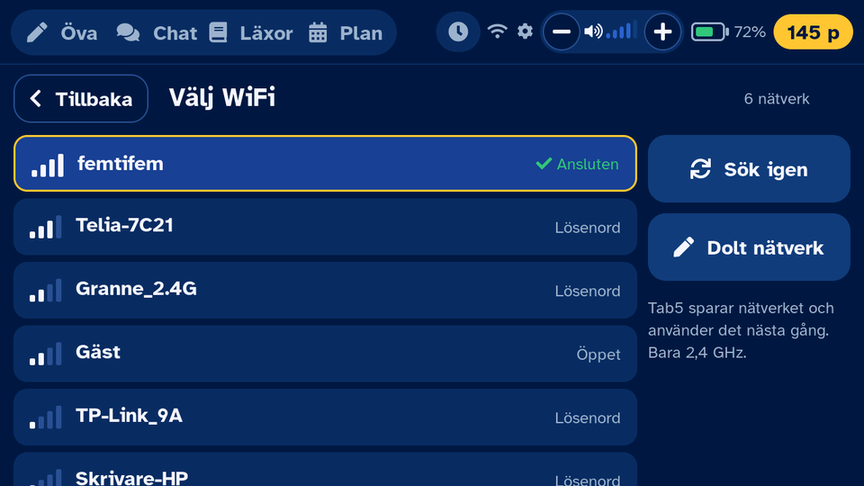<br><sub>Välj WiFi på skärmen</sub></td>
    <td align="center"><br><sub>Inställningar</sub></td>
  </tr>
</table>

### Hårdvara som stöds

Bara **M5Stack Tab5** (ESP32-P4), med eller utan batteri:

| Modell | Vad |
|---|---|
| Tab5 Kit (K145) | Med löstagbart NP-F550-batteri – rekommenderas, går att ha på skrivbordet utan sladd |
| Tab5 (C145) | Utan batteri – drivs via USB-C (eller ett batteri köpt separat) |

| Del i Tab5 | Används av Pluggis |
|---|---|
| ESP32-P4 (två RISC-V-kärnor), 16 MB flash, 32 MB PSRAM | ✅ firmware och skärmbuffertar (i PSRAM) |
| 5" IPS-skärm 1280×720 med pekskärm (GT911, eller ST7123/ST7121 på nyare exemplar) | ✅ via M5Unified/M5GFX |
| ESP32-C6 för WiFi (2,4 GHz) | ✅ bara 2,4 GHz-nät |
| Två mikrofoner (ES7210) | ✅ *Håll in och prata* / svara med rösten (talet tolkas lokalt på servern) |
| Högtalare 1 W (ES8388 + NS4150B) | ✅ coachens röst, uppläsning, ljud vid rätt/fel |
| Batteri och laddning (INA226) | ✅ batterinivå, laddning, avstängning, klockläget på laddaren |
| Kamera 2 MP (SC2356), realtidsklocka (RX8130CE, tiden tas från nätet), microSD, USB-A, RS485, Grove/M5-Bus, rörelsesensor (BMI270), hörlursuttag | – används inte (läxor fotas med telefonen) |

Andra ESP32-skärmar (Core2, CoreS3, Cardputer m.fl.) stöds inte: gränssnittet är byggt för Tab5:s 1280×720.

### Komma igång med Tab5

- Kopiera `include/config.example.h` till `include/config.h` och fyll i serverns **IP-adress** och **elevens kod**
  (`PLUGGIS_CODE`, samma som i elevchatten). WiFi, server och kod kan också väljas på skärmen under ⚙ – det sparas
  i Tab5 och går före `config.h`.
- Flasha med PlatformIO: koppla USB-C, håll reset ~2 s tills den gröna lampan blinkar snabbt, `pio run -t upload`.
- **Felsökning:** tryck på WiFi-ikonen eller *Ansluter* för WiFi, IP, server, chatten, senaste fel och minne.
  Servern loggar nekade skärmar (`docker compose logs pluggis | grep -i enhet`).

Mer i [firmware/tab5/README.md](firmware/tab5/README.md).

## Säkerhet och integritet

Det här hanterar en minderårigs röst, bilder och skolarbete.

- **Föräldravyn loggar in med lösenord.** Det sätts med `PLUGGIS_ADMIN_PASSWORD` i `.env` när servern startar
  (minst 8 tecken) och sparas som en PBKDF2-hash; raden kan sedan tas bort. Inloggningen är en signerad cookie
  (HttpOnly, SameSite=Strict) som gäller i 30 dagar. Under **System → Anslutning** kan du byta lösenord, logga ut
  eller *Logga ut överallt*. Högst 10 fel försök per 10 minuter och adress. Glömt lösenordet: skriv ett nytt i
  `.env` och starta om.
- **Elevchatten och Tab5 använder elevens kod** och når bara den elevens data. Det finns ingen delad token:
  utan inloggning eller elevkod är allt stängt.
- Elevkoden (5 tecken): högst 20 fel per 10 minuter och adress och högst 300 totalt från alla adresser – samma
  spärr för appen och Tab5. Byt kod under Elever om den kommit ut.
- Metrik (`/actuator/prometheus`) finns bara på port 9091, som docker-compose bara öppnar mot den egna datorn.
- **Bäst: nå Pluggis via Tailscale** (eller annan VPN) i stället för att öppna en port mot internet – då kan bara
  era egna enheter nå den alls.
- **Ska den ändå ut på internet:** bara bakom https (t.ex. Caddy eller Tailscale Funnel), aldrig port 8080 direkt,
  annars går lösenord och elevkod i klartext. Sätt `PLUGGIS_FORWARD_HEADERS=native` och se till att 8080 inte kan
  nås förbi proxyn (t.ex. `127.0.0.1:8080:8080` i docker-compose).
- Elevens innehåll loggas inte på INFO-nivå. Behåll det så.
- Material på en läxa sparas: texten (från Word/text, eller som Claude läst av bilden/PDF:en) och en förminskad
  sidbild för foton, så att eleven kan titta på sidan igen och få den uppläst. Det tas bort med läxan eller eleven.
  Bilder som laddas upp för att skapa *nya* läxor sparas inte.
- Prata igenom med eleven vad som sparas och vad en förälder kan se.

## Nästa steg

1. Kompilera och kör testerna lokalt (`mvn verify`).
2. MCP-server så att samma läxlista nås från Claude-appen och hemagenten.
