# Pluggis on the M5Stack Tab5

Copy `include/config.example.h` to `include/config.h` and fill it in before building (see [Flashing](#flashing)).
The older firmware without LVGL has been removed (it's still in the git history).

## Screens

Drawn with the simulator from the real interface code and test data (`./sim/run.sh`, see
[the simulator](#see-the-screens-without-a-tab5-simulator)):

<table>
  <tr>
    <td align="center">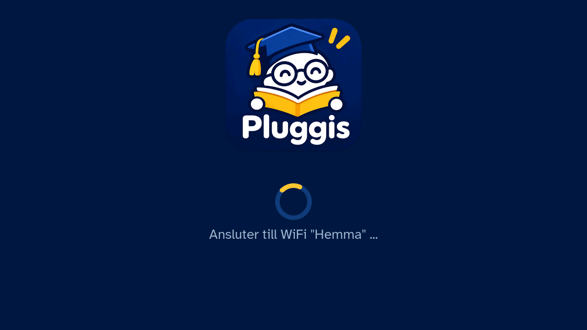 Start screen</td>
    <td align="center">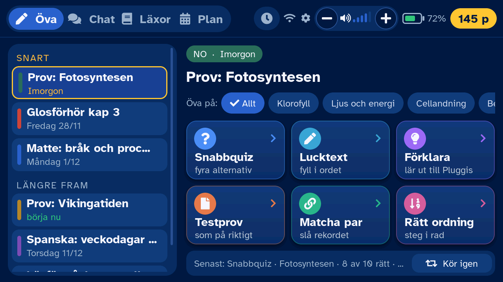 Öva: homework and six exercises</td>
    <td align="center">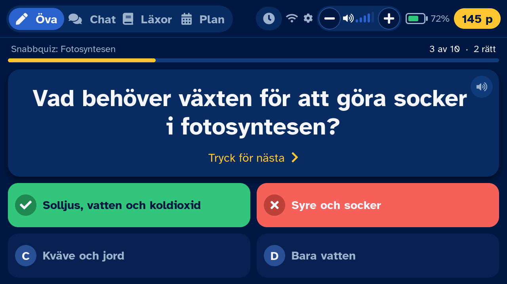 Quick quiz</td>
  </tr>
  <tr>
    <td align="center">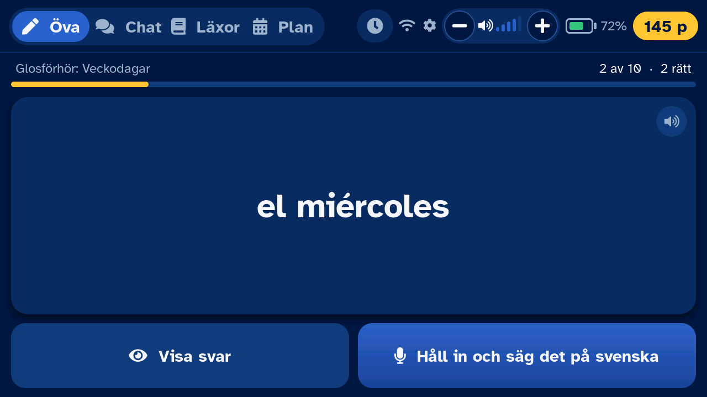 Vocabulary quiz (answer by voice)</td>
    <td align="center">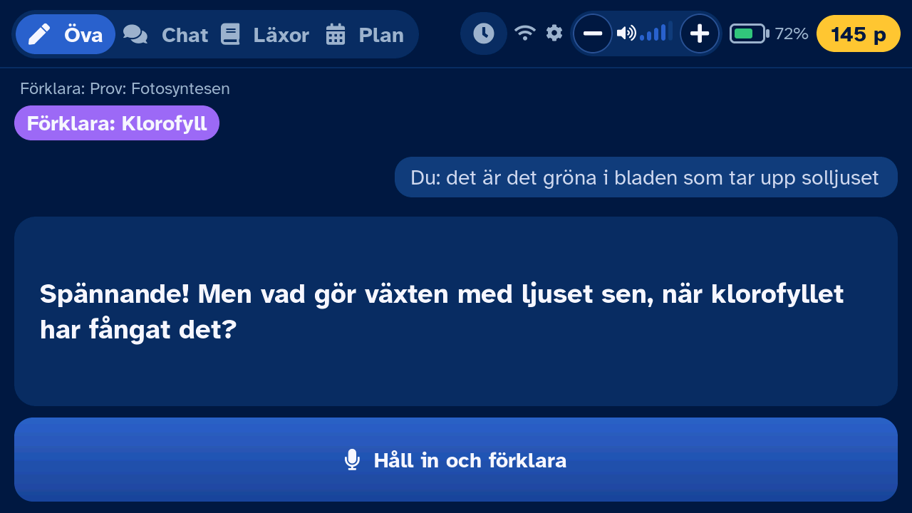 Explain to Pluggis</td>
    <td align="center">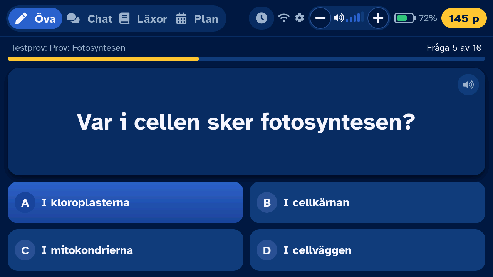 Mock test</td>
  </tr>
  <tr>
    <td align="center">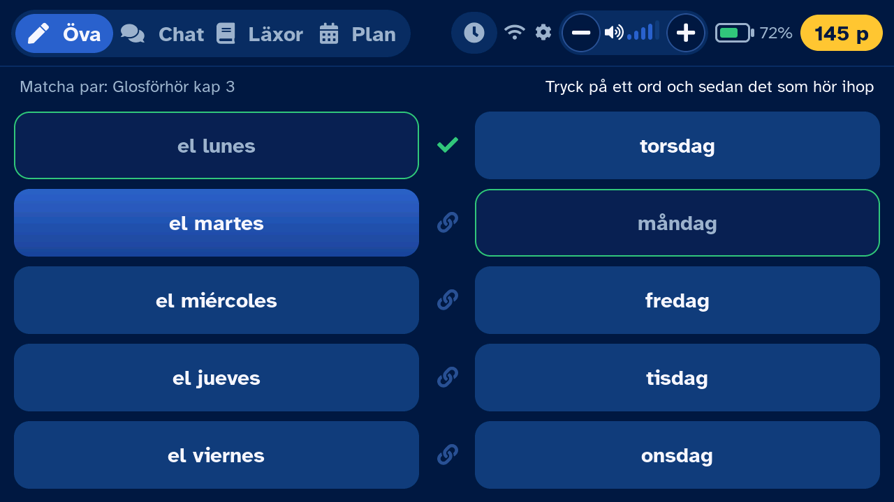 Match pairs</td>
    <td align="center">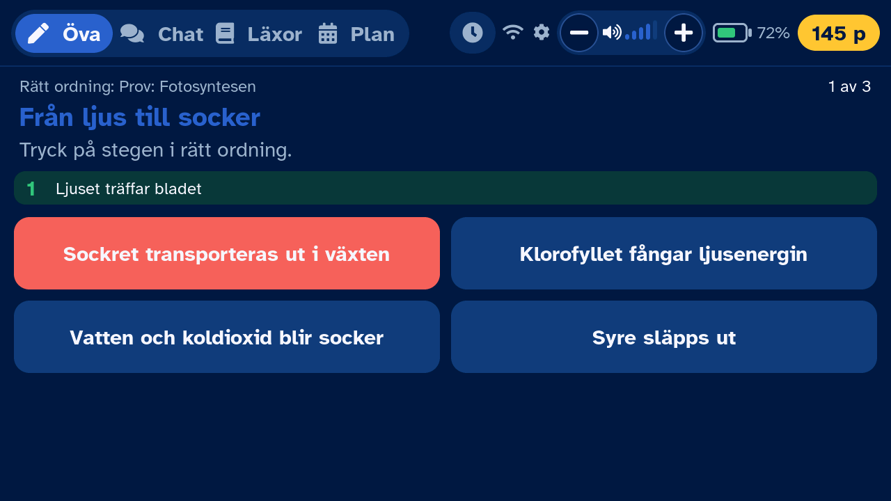 Right order</td>
    <td align="center">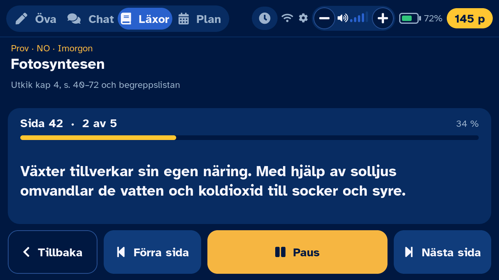 Listen to the homework page by page</td>
  </tr>
  <tr>
    <td align="center">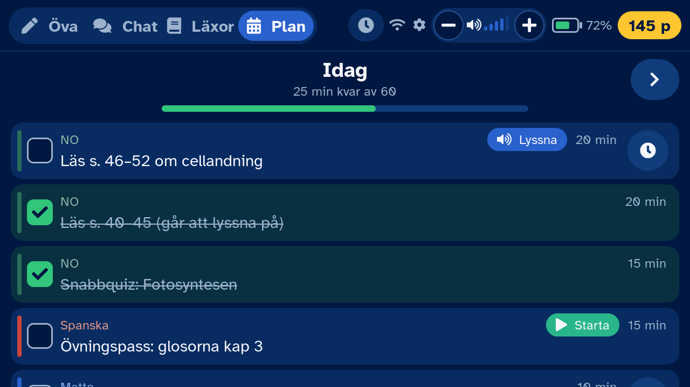 Plan with Lyssna and Starta</td>
    <td align="center">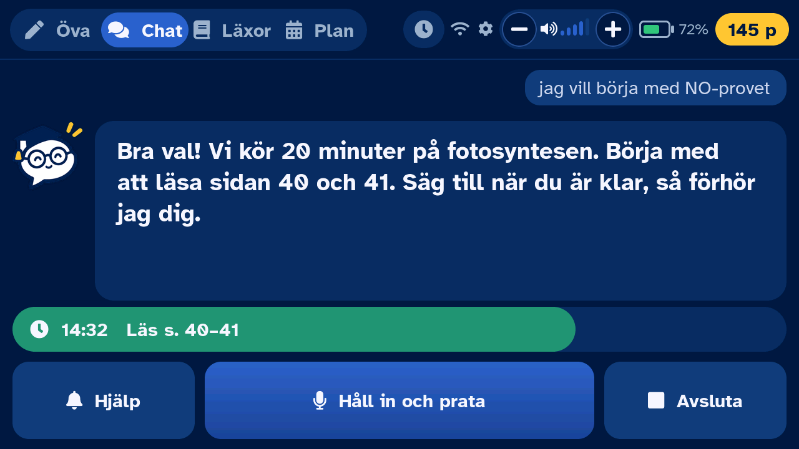 Chat with the coach</td>
    <td align="center">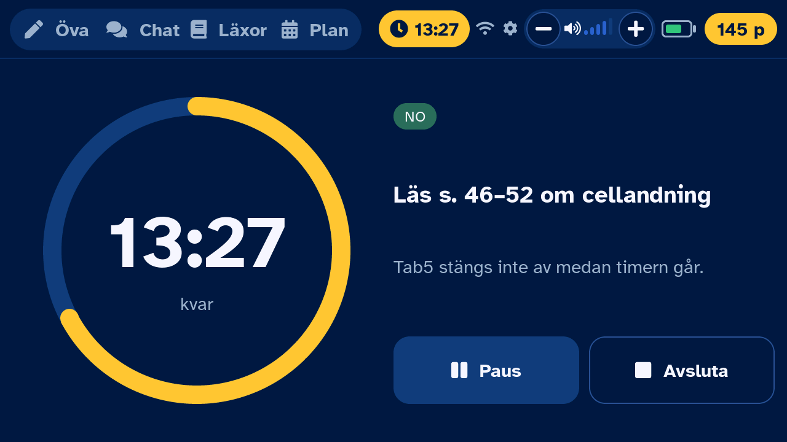 Focus timer</td>
  </tr>
  <tr>
    <td align="center">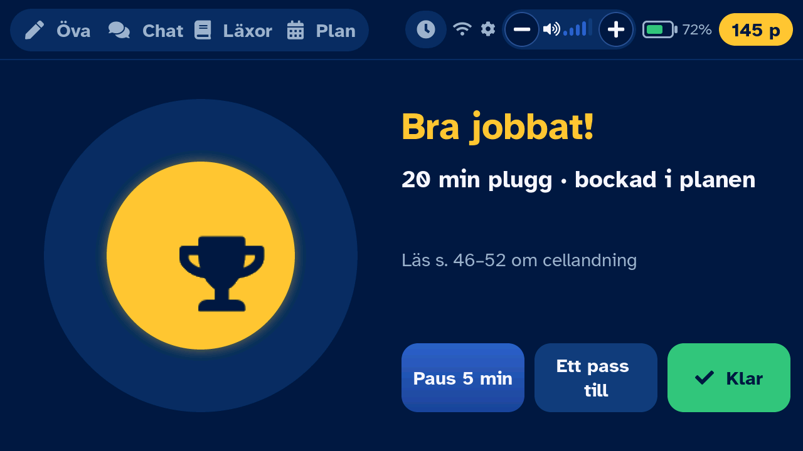 Focus session done</td>
    <td align="center">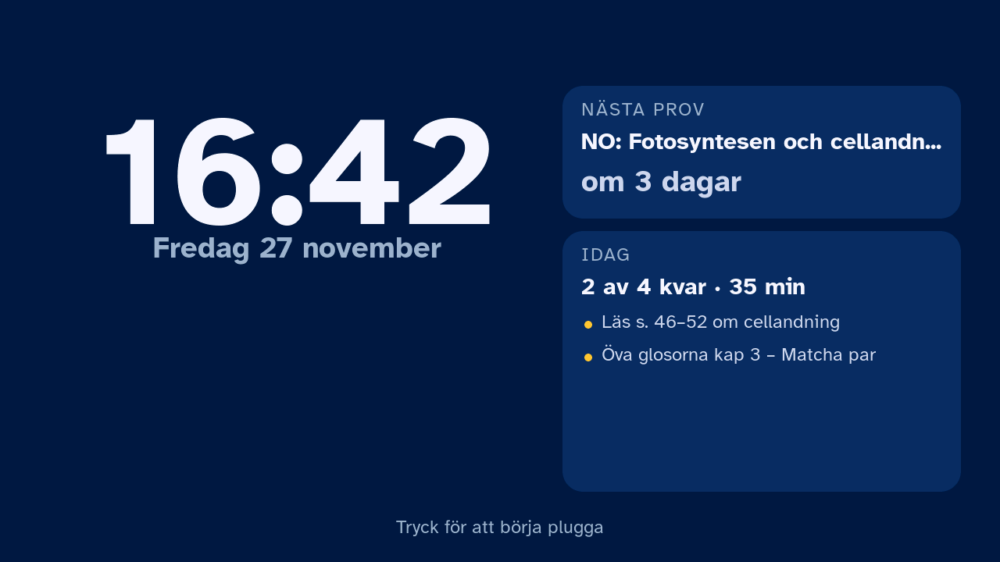 The clock on the charger</td>
    <td align="center">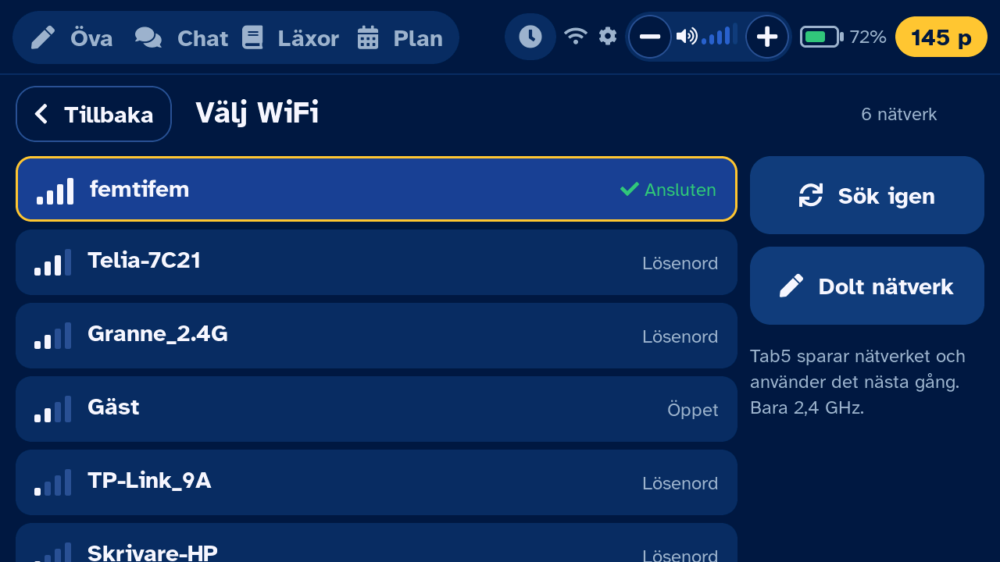 Choose WiFi on the screen</td>
  </tr>
  <tr>
    <td align="center">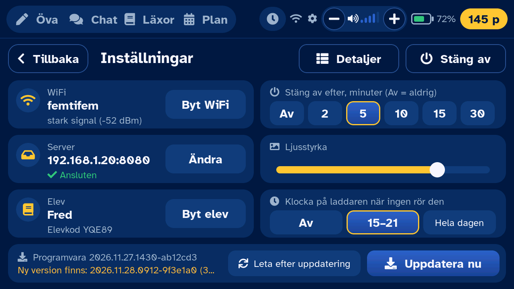 Settings</td>
    <td align="center">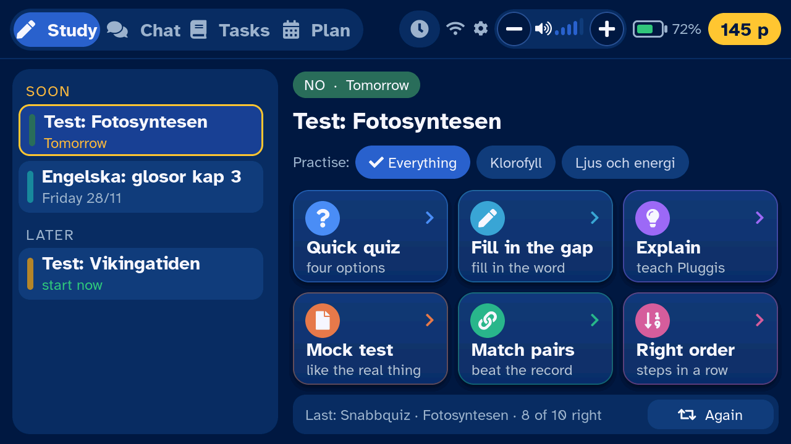 The same in English</td>
    <td align="center">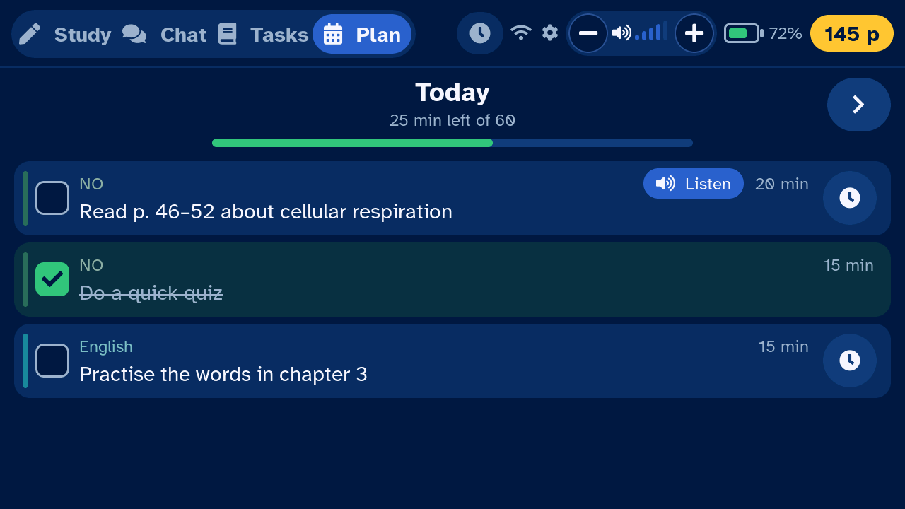 Plan in English</td>
  </tr>
</table>

## Hardware

Only the **M5Stack Tab5** (ESP32-P4), with or without a battery:

| Model | What |
|---|---|
| Tab5 Kit (K145) | With a removable NP-F550 battery (7.4 V, 2000 mAh) – recommended, can sit on the desk without a cable |
| Tab5 (C145) | Without a battery – powered via USB-C (or a battery bought separately) |

| Part of the Tab5 | Used by Pluggis |
|---|---|
| ESP32-P4 (two RISC-V cores), 16 MB flash, 32 MB PSRAM | ✅ firmware (two app partitions for updates over WiFi) and screen buffers in PSRAM |
| 5" IPS screen 1280×720 with touch (GT911, or ST7123/ST7121 on newer units) | ✅ via M5Unified/M5GFX and LVGL 9, landscape |
| ESP32-C6 for WiFi (2.4 GHz) | ✅ 2.4 GHz networks only (an iPhone hotspot needs *Maximise Compatibility*) |
| Two microphones (ES7210) | ✅ *Håll in och prata* (hold and talk) and spoken answers – recognised on the server (Whisper) |
| 1 W speaker (ES8388 codec + NS4150B amplifier) | ✅ the coach's voice, read-aloud, sounds for right/wrong, the start sound |
| Battery and charging (IP2326, INA226) | ✅ battery level, charging, shutdown time, the clock mode on the charger (USB power is detected) |
| Power button | Hardware only: one press turns it on, a double press turns it off, a press while on resets |
| 2 MP camera (SC2356), real-time clock (RX8130CE – the time is taken from the network), microSD, USB-A, RS485, Grove/M5-Bus, motion sensor (BMI270), headphone jack | – not used (homework is photographed with the phone) |

Other ESP32 screens (Core2, CoreS3, Cardputer etc.) aren't supported: the interface is built for the Tab5's 1280×720.

## How it's built

Firmware for the desk screen (PlatformIO/Arduino). Talks to the server according to [docs/protocol.md](../../docs/protocol.md).

The interface is drawn with **LVGL 9** in `src/ui.cpp` (buttons that sink when pressed, lists scrolled with a finger,
animations) in the logo's colours (dark blue and yellow), with the logo on the start screen and the figure in the chat
(`include/brand.h`), in the Atkinson Hyperlegible typeface – built to be easy to read – with å, ä, ö and icons
(`src/fonts/`). `src/main.cpp` handles WiFi, audio and the server and fills in what should be shown; `ui.cpp` knows
nothing about the hardware.

The on-screen texts are in Swedish by default and in English when the student is switched to English
(`src/lang_en.h`). UI labels below are quoted in Swedish, with the English meaning.

**Tabs at the top (the Tab5 starts on Öva):**
- **Öva** (Practise) – homework and tests on the left (passed ones are hidden; by date, *Snart* / *Längre fram* = soon / later, scrolled with a
  finger, subject colour, *börja nu* = start now for things further ahead that already have tasks in the plan). On the
  right: the selected homework, *Öva på:* sub-topics and the six exercises – quick quiz, fill in the gap, Explain,
  mock test, match pairs, right order. At the bottom *Senast* (last) with *Kör igen* (again). Everything is made new
  every time (no saved decks). Explain and written questions are answered by voice.
  On language homework (Spanish, English, vocabulary …) Explain becomes the **vocabulary quiz** (*Glosförhör*):
  Pluggis picks out the words from the material, the Tab5 says the word and the student answers aloud – in Swedish,
  or in the language being learned (then the multilingual Whisper on the server recognises the answer). The answer
  is judged directly – any of the answers is enough ("hunden / en hund"), with or without an article. Knew/didn't know
  as usual.
- **Chat** – the coach: the reply on the screen and in the speaker, a session timer, *Börja/Hjälp* (start/help),
  *Håll in och prata* (hold and talk), *Avsluta* (finish).
- **Läxor** (Homework) – homework and tests; on a homework all material is read aloud page by page
  (*Spela/Paus, Förra, Nästa sida* = play/pause, previous, next page), and where you are is saved so that you can
  continue later (also in the app).
- **Plan** – one day at a time (< >); tap a task to tick it off or read the pages aloud. On a practice task
  ("Övningspass: …") *Starta* runs a practice session: the focus timer counts down the task's minutes while the
  exercises take turns (quick quiz, match pairs, fill in the gap, right order, Explain or the vocabulary quiz), and the
  task is ticked off when the time is up. "Testprov i Pluggis" starts the mock test. ⏱ on other rows starts the focus
  timer for the task.
- ⏱ **Focus timer** top right (free session: 15, 25 or 45 min) – a big countdown, *Paus/Fortsätt* (pause/continue),
  *Avsluta* (finish), a reminder when 5 minutes are left and a reward when the session is done (practice time and
  points as usual; started from the plan, the task is ticked off). Then *Paus 5 min* (5 min break), *Ett pass till*
  (one more) or *Klar* (done). The timer is shown in the top bar on all tabs. While it runs the Tab5 doesn't switch off;
  without touches the screen dims after a minute.
- Volume − / + (saved) and battery level top right.

**Clock mode:** if the Tab5 is on the charger when the shutdown time has passed, a clock with the next test and what's
left today is shown at low brightness instead of a black screen – during study time (15–21, or 7–22 with
*Hela dagen* = all day). A tap wakes it. On battery it switches off as usual. Set under ⚙ → *Klocka på laddaren*.

The coach's audio comes as 16 kHz mono in 8 kB chunks (`audioChunk` in hello). Not yet: the camera (photos are taken
with the phone) and the Dual Button.

## Settings on the screen

Tap ⚙ top right. There you find **WiFi** (change network), **Server** (IP address, tested before it's saved),
**Elev** (student: the student's code, tested against the server – the code decides which student the screen shows),
**Stäng av efter** (switch off after: off, 2, 5, 10, 15 or 30 minutes), **Ljusstyrka** (brightness),
**Klocka på laddaren** (clock on the charger: off, 15–21, all day), **Detaljer** (details: WiFi, server, chat, latest
error, memory), **Programvara** (software: check for and install updates) and **Stäng av** (turn off completely).
Everything is saved in the Tab5 and takes precedence over `config.h`, so `config.h` is only needed the first time.

**Power button:** one press turns the Tab5 on, a double press turns it off (handled by the hardware – the firmware
can't change it). A single press while it's on is a reset. On the USB cable the Tab5 can't turn itself off; *Stäng av*
then says so.

**Sound after a restart:** a soft restart (an update or a reset) doesn't reset the audio chip (ES8388) and amplifier,
so the firmware shuts the audio down before restarting and starts it again at every boot. A short, calm start sound
plays when the Tab5 is online. If it's still silent, turn it off completely and on again.

## Changing WiFi on the screen

Tap the WiFi icon top right → **Byt WiFi** (change WiFi) (or **Välj WiFi** on the start screen if it doesn't get
online). The Tab5 searches for networks; tap one and type the password on the on-screen keyboard (**Visa** shows what
you typed). **Dolt nätverk** for a hidden network. The network is saved in the Tab5 only when the connection succeeds,
and then takes precedence over `PLUGGIS_WIFI_SSID`/`PLUGGIS_WIFI_PASS` in `config.h`. With a wrong password the Tab5
goes back to the network it had. 2.4 GHz only.

## See the screens without a Tab5 (simulator)

`./sim/run.sh` builds the interface for the computer and draws all screens with test data to `sim/out/*.png`
(requires gcc, g++, git and python3 with Pillow; the first time LVGL is fetched and built, which takes a few minutes).
The test data is in `sim/sim_main.cpp` – change it there to try long texts, lots of homework and so on.

## Fonts

`src/fonts/*.c` are made with [lv_font_conv](https://github.com/lvgl/lv_font_conv) from Atkinson Hyperlegible
(regular 24/30, bold 30/38/60, Latin-1, and digits only at 120/200 for the timer and the clock) plus LVGL's
FontAwesome icons and a few extra (microphone, chat, book, calendar, light bulb, question mark, link, order, trophy,
clock). The command is at the top of each file.

## Flashing

1. Install [PlatformIO](https://platformio.org/install/cli) (or VS Code + PlatformIO).
2. `cp include/config.example.h include/config.h` and fill in WiFi, the server's IP address and **the student's code**
   (`PLUGGIS_CODE`, the same 5 characters as in the student chat – admin → System → Students). The code is enough:
   the server knows which student it belongs to, and the screen only reaches that student's homework, plan and points.
   If the code is changed in admin (*New code*) it has to be changed here too (or on the screen under ⚙).
   `config.h` is never checked in.
3. Connect the Tab5 with USB-C. Enter download mode: hold the reset button for ~2 s until the green light blinks
   quickly.
4. `pio run -t upload`, and `pio device monitor` for the log.
5. In admin: System → Tab5 to show the device's connection status.

The first build downloads the ESP32-P4 toolchain and takes a few minutes.

## Updating over WiFi

Once this firmware is on the Tab5 (one USB flash), later versions are installed from **⚙ → Check for update →
Update now**. CI builds `firmware.bin` on every push to `main` and publishes it in the GitHub Release `tab5`; the
Pluggis server fetches it and the Tab5 downloads it from the server. See the main README, *Updating the Tab5 over
WiFi*. The version shown on the screen comes from `PLUGGIS_FW_VERSION` (set by CI); a local build shows "egen" and
the build date.
